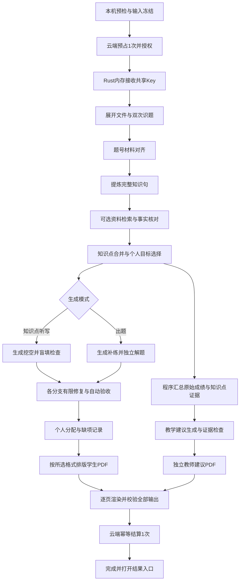

# 个性化听写、出题与教学建议工作流：完整实施计划

日期：2026-10-28  
修订：v2，加入双模式、可选 PDF 组织方式、教师教学建议及严格 PDF 验收；本文当前各节替代 v1 中的单听写模式和固定双格式输出约定。保留原文件名以兼容既有链接。

状态：2026-10-28 阶段 A 已实现；按负责人要求提前完成阶段 D 的接口/客户端授权接线并部署正式云端，阶段 E 的模型适配入口已接好，真实 Key 待管理员配置，真实模型尚未验收。阶段 B/C、新版 PDF 与正式计次、真实资料验收仍待实施。本文目标不表示全部已经开发或上线，实际范围见 `计划进度表.md` 最新记录。
适用项目：错题智能推送 Agent，Windows / Tauri / React / TypeScript / Rust，云端 Fastify + SQLite。

## 1. 已确定的目标与边界

### 1.1 最终交付

用户导入本场考试、上传空白卷，在生成前选择模式和 PDF 组织方式，点击一次“生成报告”，程序自动完成识题、知识分析、内容生成、校验、按学生分配、班级教学建议及 PDF 导出。生成过程中不要求教师标注知识点、确认题干、审核采用或手动组卷。

两种模式均属于首版必做功能，不将出题模式留为可选远期项：

| 生成模式 | 主要内容 | 校验重点 |
|---|---|---|
| `dictation` 知识点填空（听写） | 完整知识句中挖掉关键词、关键条件或结果；附答案与纠错说明 | 句子还原、语境充分、答案唯一或明确可接受表述、盲填一致 |
| `exercise` 出题 | 围绕个人失分题和知识目标生成补练题，支持选择、简答、计算等已验证题型；附答案解析 | 条件自足、选项有效、独立解题、计算和评分点、知识目标匹配 |

首版一次任务选择一种模式。两种模式的缓存、结果、预算和提示词分别标识，不以改标题的方式把听写单当作出题结果。后续切换模式属于新的内容生成请求，不等同于重新排版；是否跨模式另扣次数见第 11 节的待确认规则。

输出参考用户提供的两页听写样例，但不将该样例的学生资料、题目内容或原文件提交到代码仓库：

- 听写页：学生姓名、考试名称、说明、编号、知识点挖空。
- 答案页：编号对应的参考答案、可接受表述、原题题号、简短纠错说明。
- PDF 组织方式在开始前二选一：`individual` 每名学生分开输出，或 `combined` 全班学生输出到一个 PDF。程序只生成所选的学生输出形式；内容较多自动分页，不强行限制每人两页。
- 两种模式均额外生成一份独立的 `teacher-guidance.pdf`，用于教师后续教学，内容来源于本场原始成绩与知识点映射。合订选项指学生材料合订，教师建议默认单独存放，避免随学生练习一并发放；因此合订模式正常为 1 份学生 PDF + 1 份教师 PDF。
- 无失分的学生输出“本场暂无需补充的知识点”；没扫/无原卷的学生输出状态说明，不虚构个人错误。
- 生成失败时明确失败或部分完成，不将缺失内容伪装成完整报告。

生成前只需要选择模式、学生 PDF 组织方式及数量/难度等设置。教师建议随本批自动生成，不另设人工审核环节。已生成内容可重新导出另一种组织方式，复用同批内容、不重新调用模型、不重复扣次。

### 1.2 执行位置

按负责人选择，采用“云端核验并下发共享模型 Key，客户端直连模型”的架构。

| 部分 | 执行位置 |
|---|---|
| 软件登录、余额预占、任务授权、心跳、结算 | 负责人云服务器 |
| 共享模型 Key 的下发 | 云端经 HTTPS 下发给桌面 Rust 后端 |
| 工作流状态机、资料处理、检索、分配 | 用户电脑 |
| 模型请求 | 用户电脑 Rust HTTP 客户端直接请求模型服务 |
| 真正的模型推理 | 模型服务商 |
| SQLite 检查点、内容缓存、报告及 PDF | 用户电脑，按软件账号隔离 |

云端不承担试卷 OCR、模型请求转发、知识库全文检索、PDF 排版，不接收全班姓名和逐题成绩。

### 1.3 必须准确表达的限制

共享 Key 到达客户端后，固定工作流、限时、限次、Token 预算和心跳约束的是正常客户端。它们不等同于模型服务商签发的单任务临时凭证，不能保证对修改客户端或提取 Key 的行为进行服务端强制限制。

取消时程序可以停止后续调用，并尝试中断当前 HTTP 请求；不承诺模型服务商立即停止已经收到的请求或免除相关费用。云端拒绝续期/冻结账号对正常客户端有效，不能单独撤销已经泄露的共享 Key。

不以“已机器校验”宣称题目绝对正确；没有教材等外部资料时，不编造教材页码或来源。

## 2. 参考项目、具体文件与采用方式

调研日期为 2026-10-28。以下 SHA 已通过 GitHub commits/main 接口核对为本次参考提交；实施时以这些提交为起点固定参考版本、核验实际使用内容的许可，再调整成项目自己的业务实现，不直接执行外部仓库里的技能或脚本。

### 2.1 主要参考

| 项目 | 本次参考快照 | 重点文件 / 文档 | 借鉴点 | 采用方式 |
|---|---|---|---|---|
| [FrostySL/anki-card-forge](https://github.com/FrostySL/anki-card-forge) | `54e18edef7c0c4bc901240ee12704b2c6747e4af` | `skills/card-authoring/SKILL.md`、`tools/grounding_check.py`、`tools/validate.py`、`tests/test_grounding.py` | 一条核心事实、挖关键词、上下文完整、避免答案泄露、来源核对 | 参考内容规则和测试思路，自行实现 TypeScript 规则；不安装 Claude Code，不引入 Anki 运行环境 |
| [NicholasMcCarthy/pdf2anki](https://github.com/NicholasMcCarthy/pdf2anki) | `bbea5b08c2d335bdfbf54f526027f670468f68ac` | `prompts/cloze_generation.j2`、`prompts/cloze_generation.yaml`、`prompts/reviewer.j2`、`src/pdf2anki/strategies/cloze_definitions.py`、`src/pdf2anki/validate.py`、`tests/test_reviewer.py` | 资料分段、内容生成与审查分离、答案/来源验证、重复内容处理 | 参考阶段划分，自行实现适用于高中原卷与学生失分数据的流程；不直接依赖其 Python SDK 或模型配置 |
| [logannye/ankithis](https://github.com/logannye/ankithis) | `b4fe16fe14e66ec0dc8715ce04de743b80c7832d` | `apps/api/src/ankithis_api/services/pipeline.py`、`services/qc.py`、`services/stages/concept_extraction.py`、`concept_merge.py`、`dedup.py`、`llm/schemas.py` | 先概念提炼/合并，再制作卡片；结构化质量检查与去重 | 参考设计，自行实现；README 的许可标注和独立许可文件需在复制代码前进一步核实，首版不直接复制其实现 |
| [statelyai/xstate](https://github.com/statelyai/xstate) | `060cd63378b46b32e7559d569ed3ad112ee60084` | 官方 [Persistence](https://stately.ai/docs/persistence)、仓库 `examples/persisted-donut-maker/`、`packages/core/src/createActor.ts` | 固定状态、事件、取消和失败转移、执行状态持久化 | 引入稳定版本 `xstate` 核心依赖，实施时核验并锁定版本；不照搬 main 上可能与稳定版不一致的接口 |
| [typst/typst](https://github.com/typst/typst) | 复用本项目已有本地编译器及现有版本锁定 | 项目 `app/apps/desktop/src-tauri/src/pdf_export.rs`、`app/packages/pdf/src/` | 中文 PDF、模板化排版、分页、公式和上下标 | 直接复用现有本地工具，新增听写模板和自动导出流程 |

上述内容工具主要面向 Anki，用于听写分支的知识点与挖空处理；出题分支优先复用本项目 `app/packages/agent/src/index.ts` 中的共享题池、`generate/solve` 分离、重出和组卷基础，再补自动验收规则。教学建议由本机统计模块和单独的受限写作阶段实现，不把 Anki 项目的卡片评分当作班级学情诊断。不生成 Anki 卡包，不引入其网页/账号/数据库整套后端。

固定版本入口：

- [anki-card-forge 参考提交](https://github.com/FrostySL/anki-card-forge/tree/54e18edef7c0c4bc901240ee12704b2c6747e4af)
- [pdf2anki 参考提交](https://github.com/NicholasMcCarthy/pdf2anki/tree/bbea5b08c2d335bdfbf54f526027f670468f68ac)
- [AnkiThis 参考提交](https://github.com/logannye/ankithis/tree/b4fe16fe14e66ec0dc8715ce04de743b80c7832d)
- [XState 参考提交](https://github.com/statelyai/xstate/tree/060cd63378b46b32e7559d569ed3ad112ee60084)

本次已核对 anki-card-forge、pdf2anki 和 XState 的 MIT 许可信息；实际复制/改编时仍须保留对应版权与许可文本。AnkiThis 仅参考设计，不在许可文件问题未核实前复制代码。

### 2.2 暂不引入

- [langchain-ai/langgraphjs](https://github.com/langchain-ai/langgraphjs)：参考其检查点、可恢复执行和幂等思路。当前流程是固定顺序，首版用 XState 即可，不同时引入两套调度框架。
- [docling-project/docling](https://github.com/docling-project/docling)：作为未来复杂 PDF、版面和 OCR 的备选。首版复用 PDF.js、Word 展开及已有图像识别；真实原卷测试证明有明显短板后，再评估引入成本。
- 向量数据库、多 Agent 自由规划、联网自主搜索、模型自行编写并执行任意代码：不进入首版。已有本地 SQLite 检索继续使用。

凡实际复制或改编的开源代码/提示词，实施时在 `THIRD_PARTY_NOTICES.md` 写明来源、版本、许可与改编范围；仅阅读参考不宣称代码已集成。

## 3. 当前代码基础及差异

| 已有模块 | 可复用部分 | 必须改造部分 |
|---|---|---|
| `app/packages/agent/src/preparePaper.ts` | 两次识题、题号匹配、取消检查 | 目前不一致就转人工核对；改为自动定向重读、失败隔离；支持跨页材料 |
| `app/packages/agent/src/index.ts` | 匿名化、失分选题、共享题池、独立解题和有限重出 | 听写分支新增完整知识句与挖空；出题分支保留并完善变式生成；两者取消人工审核状态依赖 |
| `app/packages/agent/src/storage.ts` | 资料/结果一致性校验 | 现有数据强制要求知识库依据和人工审核；新增带 mode 的双模式任务、教学建议结构与校验器 |
| `app/packages/knowledge/src/`、`src-tauri/src/knowledge.rs` | 本地资料、FTS 检索、来源页码 | 知识库改成可选，不再空库就阻止识题/生成 |
| `src-tauri/src/model.rs`、`model_http.rs` | 固定供应商端点、结构校验、错误分类、匿名检查 | 新增听写/出题/教学建议固定阶段、任务授权、每次调用预算、可取消 HTTP、受控共享 Key 会话 |
| `src-tauri/src/account.rs`、`server/src/app.mjs` | 登录、预占、任务幂等、余额流水 | 新增工作流授权与心跳；由 PDF 验收后结算，而不是第一道自检题通过就扣次 |
| `src-tauri/src/pdf_export.rs` | 本机 Typst、公式转换、超时、临时目录、非覆盖写入 | 听写/出题/教师模板、可选分开或合订、自动保存、逐页渲染及排版验收，不要求人工 approved |
| `app/apps/desktop/src/AgentWorkspace.tsx` | 进度、取消、账号与本机资料接线 | 调度移出 React 组件；界面精简为生成/停止/恢复/打开结果 |

旧版出题记录、已有 PDF 和历史成绩保留。新增结构使用独立 `workflowVersion` / `schemaVersion`，不把旧版审核结果直接当成新格式听写结果。

## 4. 固定流程与成功定义



用户在点击生成之前准备资料、选择输出设置。之后不弹出题干确认、知识点选择、逐题采用或保存位置对话框。

### 4.1 目标学生与缺失情况

- 目标学生：本场具有可用逐题记录，且当前补练规则下存在失分题的学生。真实的 0 分可参与听写生成；“对比考试排除零分”的规则只属于名次评选，不套用到这里。
- 没扫/无原卷：不推断其失分题，不生成假听写；仍可输出对应状态页并计入全班清单。
- 满分/无纳入失分题：输出无需补充说明，不调用模型为其硬凑条目。
- 主观题只有整题成绩：依据整题相关内容整理复习点，不断言某一小问错在哪里。
- 缺少学生作答选项时，不生成类似“学生 D→正确 B”的个人选项依据。

### 4.2 正式完成条件（首版建议默认，真实资料验证后可配置）

1. 整个输入与任务冻结版本一致，所有目标学生均有状态和分配结果。
2. 每位目标学生至少有 1 个所选模式的机器校验通过内容项；听写按有效空/知识目标验收，出题按完整可解题目/目标验收，不混用单位。
3. 对预先确定的个人目标知识点，覆盖率至少 80%；未覆盖项必须列出。此比例按“选定目标点”计算，不以删除失败项的方式抬高比例。
4. 选定目标之前先保留原始失分题清单。识题失败/知识句无法核实的原题始终显示在未覆盖清单，不因没有提炼出知识点而悄悄消失。
5. 所选组织方式的全部学生 PDF、独立教师建议 PDF、验收记录与结果清单全部写入成功，并通过第 10 节质量门槛；未选择的另一种学生 PDF 形式不是完成条件。
6. 未发生任务取消、授权拒绝、预算超限或资料版本冲突。
7. 教师建议引用的统计均可回算；没有可识别知识点时必须如实给出证据不足说明和原题层面建议，不能编造知识点掌握结论。

达到门槛但有少量缺项，结果标记“完成，含未覆盖项”。有目标学生完全无有效条目，或低于覆盖门槛，标记“部分完成 / 失败”，保留已有结果及缺项说明，不自动当作正式成功扣次。

80% 是方案默认值，不是已经验证的教学标准，也不是模型正确率承诺；在第一批真实试卷测试中核定。报告不能写“所有知识点已覆盖”或“答案保证正确”。

## 5. 本地状态机、限制与异常处理

### 5.1 固定状态

共同阶段：`idle → preflight → authorizing → rendering → recognizing → aligning → extracting → retrieving → verifyingFacts → merging → selectingTargets`。

模式分支：`dictation: clozing → validatingCloze`；`exercise: generatingExercises → solving → validatingExercise`。分支完成后汇合到 `assembling → aggregatingEvidence → writingGuidance → validatingGuidance → exporting → validatingPdf → settling → completed`。流程图中的独立支线表示职责依赖，不表示首版需要并发执行多个模型请求。

辅助状态：`retryWait`、`recoverable`、`partial`、`failed`、`cancelled`、`pendingSettlement`。

- 模型只返回本阶段的数据；不能指定下一步、修改预算、执行工具代码或自行打开网页。
- XState 管理状态与事件；Rust 后端重复检查任务、阶段、预算、账号和取消状态，避免只靠按钮禁用。
- 调度器为桌面会话单例，不放在组件的点击处理函数里；切换页面不取消或重复启动任务。
- 同账号同一时刻只有一批活动生成；双击、重复网络提交、重新打开页面都复用任务编号。

### 5.2 建议的初始限制

以下是开发配置初值，须经真实试卷校准后再用于正式用户，不保证这些数值对所有试卷都合适。

| 项目 | 初始规则 |
|---|---|
| 本机模型并发 | 1；先保证稳定，再通过测试决定是否提高 |
| 普通文本请求超时 | 120 秒 |
| 图片识别请求超时 | 240 秒 |
| 整批执行时限 | 45 分钟；超限进入可恢复/失败状态，不继续请求 |
| 单个不合格条目 | 最多定向修复 1 次，再盲填复检 1 次 |
| 网络错误 | 最多 1 次有限重试；认证/余额错误立即停止 |
| 心跳 | 约每 20 秒一次；连续 90 秒无法续验即暂停新模型请求 |
| 输出空数 | 默认每人目标最多 16 空，正常情况下不超过 24 空；不为凑数增加无关知识 |
| 出题数量 | 默认每人最多 5 题，首版配置范围建议 1–10 题；每个目标生成 1–2 道候选，按预计时长及覆盖去重，不套用听写的空数 |
| 教学建议 | 本批 1 份；模型写作 1 次，最多修复 1 次，数值统计不调用模型 |
| 同题原子知识点 | 默认最多 3 个，优先关键概念/必要条件/核心过程 |
| 输入范围 | 不超过现有 30 页限制；首版默认单班不超过 100 人、需要处理的原题单元不超过 80；超过范围在调用前明确提示，不截掉学生后继续 |

调用预算在预检时按模式计算，不能继续用同一经验公式覆盖两种内容。设 P 为页数、B 为共同知识分析组数、C 为听写候选组数、E 为出题候选组数：共同识题预算不超过 3P，共同提炼/事实核对/必要修复预留不超过 4B；听写生成/盲填/修复/复检最多 4C，出题生成/独立解题/重出/复解最多 4E，教学建议最多 2 次，全局额外网络重试最多 8 次。请求上限分别估为 `3P + 4B + 4C + 2 + 8` 或 `3P + 4B + 4E + 2 + 8`，并受单批 200 次的初始硬上限约束。每组最多 6 个单元且受输入 Token 限制；重试次数按实际请求消耗，批量响应也逐项检查。

预算不能直接取 `min(200,估算值)` 后假装所有任务均能完成。估算超限时在发起前提示调整规模/设置，不静默缩减目标。识题导致运行中拆组超出已授权预算时停止新增调用并保留检查点；不得以重新分组重置次数。

每次发起前检查调用剩余额度、阶段上限、输入长度、单次输出上限及整批时间；收到响应后按供应商 usage 记账。Token 预算要包含输入与输出，并预留下一次请求的上限，不能只在所有调用结束后统计。具体总 Token 数与单次输出长度在模型真实请求测试后锁定，不把 Token 数换算成未经核实的固定价格。

没有返回 usage 或发生超时的请求标为用量未知，保守占用预留预算，不能按 0 Token 释放后无限重试。预算减少和检查点写入使用同一事务/受控顺序，防止重开程序后预算计数归零。

### 5.3 取消与恢复

- 停止按钮触发状态机取消和 Rust 请求取消；立即停止队列，不生成下一题。
- 已成功内容和检查点保存，未完成调用标为 `interrupted/unknown`，不得当成功。
- 崩溃重开后，先校验账号、输入摘要、版本和云端任务状态，再允许“继续上次任务”。无需教师审核内容。
- 继续任务时重新向云端领取 Key，绝不从本机 SQLite 恢复 Key。
- 已完成步骤直接复用；已经发出但没收到响应的调用可能已经产生费用，供应商未确认支持幂等时不宣称重发不会重复消费。
- 无法继续时明确结束任务，释放或等待过期释放预占；不偷偷新建一批扣第二次。

## 6. 工作流各阶段的输入输出

### 6.1 本机预检和冻结

检查软件账号、完整考试数据、试卷文件、生成模式、导出组织方式、输出目录写权限、Typst/字体/PDF渲染资源、可分析学生及目标范围。有/无知识库均允许启动。共同分析要覆盖可识别全卷以支撑教学建议，调用预算中的单元数按实际需要分析的全卷范围计算，而不只计算失分题。

先在本机创建任务目录与冻结输入快照，再申请云端预占。预检不调用模型、不下发 Key、不扣次。全部学生都没有失分目标时不建立付费任务，可按第 6.9 节输出本机确定性概况和无需补练说明；不承诺在无可用知识点映射时免费调用模型做完整知识诊断。

将输入区分为内容摘要 `contentHash` 与导出摘要 `exportHash`。contentHash 包括账号、考试/班级/学科、原始成绩、试卷文件、生成模式、数量/难度与目标设置、知识库版本、工作流和提示词版本；exportHash 再包含内容版本、individual/combined、答案组织方式、纸张/字体/模板/打印设置。成绩、试卷、模式或目标变化不能复用旧内容；单纯改分开/合订、目录或分页不重新调用模型，也不新扣次数。

### 6.2 文件展开、识别与题号对齐

- PDF/Word 优先提取可用文字，同时保留页码；图片和文字不完整页使用已有视觉调用。
- 两次读取分别保存，不把第一次识别结果当作第二次识别的答案。
- 以程序规则核对题号、选项、单位、否定词、数字、上下标、跨页和共用材料；不能只依赖整段去空白字符串一致。
- 不一致时最多定向重新读取一次。仍有歧义时隔离该题，不要求教师核对、不编造缺失条件。
- 保留独立 `recognized_by_machine` / `alignmentStatus`，不把原有 `confirmed=true` 冒充教师确认。
- 题号必须落在本场可匹配集合；共享材料先组成一个单元，之后保留其各原题编号。
- 2026-10-28 负责人调整：只转录题干、选项与必要共用文字材料，忽略题内图示及图中标签、数值和关系。扫描页仍通过视觉接口读取印刷文字，但提炼与核验不附带原图；图示存在不阻断文字识别，必须依赖图示才能成立的知识点跳过。
- 同日进一步限定：只读取题干和各小问正文文字；表格也不读取，含杂交示意图中的文字/比例/箭头、图下注释与表头/单元格均排除。不因某小问依赖缺失图表拒绝整道大题，其余正文已明确的独立事实仍提炼；原题空白不得由识题模型填答案。

### 6.3 提炼完整知识句

以原题文字单元为输入，输出最多 3 个原子知识点：规范名称、独立理解所需文字背景、完整正确陈述、关键限定条件、易混概念、候选挖空片段及原题来源。文字不足或目标全部依赖图示时允许空结果，明确记录文字证据不足，不臆测图示、不删除原始失分题分母。

不直接输出横线版最终试卷。先生成可以独立阅读的完整知识句，避免后续无法核对答案。知识点名称在没有标准目录时属于机器推断，不能伪称来自权威教材目录。

生物例子可使用“细胞分化的实质是基因的选择性表达”一类完整陈述；限定条件、否定词和适用对象必须保留。涉及计算的内容保留给定条件和推导依据，不能只输出一个孤立比例。

### 6.4 可选知识库与题库

- 有可检索资料：用知识点、关键词及原题条件检索；记录文档 ID、页码、片段和原文。
- 找不到合适资料/知识库为空：进入原卷模式，继续生成，不触发现有 `knowledge_required` 全局阻断。
- 资料模式与原卷模式可以在同一批按条目区分。没有命中的条目不能借用别的条目的引用充当证据。
- 原题提供“考查范围”，不等于原题文字本身能证明模型写出的所有事实；原卷模式的结论仍需独立事实核对，保留来源类型。
- 错误干扰项不能直接当知识依据；若没有标准答案，独立解答并检查冲突，无法明确的条目跳过。
- 首版不自动上网搜教材，不要求用户先建库，也不自动把模型输出升级为权威题库。

### 6.5 事实核对、知识点合并与选择

事实核对请求不提供“正确/已审核”标签。检查陈述是否准确、范围是否适合本题、限定条件是否缺失、能否从所给证据支持。冲突时有限修复，失败隔离。

合并只针对语义和适用条件相同的原子事实，不凭知识点名称相同就合并。相近但有不同条件、不同对象或相反方向的陈述必须保留差异。每条合并记录保留全部原题映射。

个人目标由原始失分题与合并后的知识点映射决定。优先全错、失分比例较大、核心基础内容；部分得分按生成前预设规则纳入。听写每人默认最多 16 空；出题每人默认最多 5 题，两者分别预算。目标集合在最终质量筛选之前冻结，失败点进入缺项清单。

### 6.6 挖空生成与程序还原

模型输出结构化 `parts`，例如：

```json
{
  "id": "fact-001-cloze-01",
  "factId": "fact-001",
  "sourceNumbers": ["5"],
  "parts": [
    {"type": "text", "text": "细胞分化的实质是"},
    {"type": "blank", "blankId": "b1", "answer": "基因", "acceptedAnswers": ["基因"]},
    {"type": "text", "text": "的选择性表达。"}
  ],
  "correction": "细胞功能趋于专门化，不能概括为所有生理功能均增强。"
}
```

程序把所有 text 和 blank.answer 拼接，必须还原已保存的完整知识句；再用同一结构生成横线和答案页。这样不需要模型分别编两份练习与答案，避免编号错位、填空内容不一致。

每条默认 1 空，确有同一概念内部关系时最多 2 空；不整句挖空，不挖无关虚词，不删除唯一限定条件。答案要与空后已有的“期”“酶”等文字共同组成完整术语，避免重复字或评分歧义。

### 6.7 自动质量检查

程序检查：JSON/字段/大小限制、稳定 ID、原题映射、parts 可还原、空非空、可接受答案一致、句子重复、答案在同条可见文本泄露、编号和空数、公式白名单、无学生身份、无不支持的远程内容。

模型盲填：只提供挖空后的句子、必要材料和作答要求，不提供 answer、acceptedAnswers、生成解析或“已通过”结论。要求返回补全值、歧义和条件缺失情况。

比对分层：程序先做精确/格式/单位归一化；术语用显式 acceptedAnswers；数值使用经限定的计算/单位校验。仍不一致的自由文本不能靠无限询问模型“是否相同”来放行，按失败处理。

事实核对、盲填一致和语法检查分别存储。两次调用一致不是科学正确性的保证，不把单一布尔值 `passed=true` 当成充分证据。

### 6.8 出题模式的生成与独立校验

出题模式与听写共用已识别原题、知识点/材料映射、可选检索和个人目标，在 `mode=exercise` 分支生成完整的补练题，不把听写句子简单换成问号。

- 输入：目标知识点、原题与条件、学科/年级范围、候选题型、难度与数量、可用资料。
- 输出：题型、完整题干、选项（如有）、必要材料、答案、分步解析/评分点、目标知识点 ID、原题映射、预计作答时长和机器检查记录。
- 首版明确支持单选、多选、文字简答及可验证计算题。各题型分别定义 schema：单选只能有一个正确选项，多选答案集合必须与选项一一对应，简答要有具体评分点，计算题要有条件、单位和有效的结果表达。
- 共用材料保留完整题组，不拆到其他页面或学生后丢失题目成立条件；不同子问分别计数，并记录整组占用题数及预计时长。
- 按2026-10-28调整，只根据题干和选项文字生成条件自足的文字题；不使用原图或图中推断，不能输出“如图”而没有图。必须依赖图示的目标跳过，不改变考查目标来伪造可用内容。
- 不自动支持听力、作文、需要实际操作的实验任务；“实验知识分析题”与“实际操作任务”分开识别，不因包含“实验”二字就全部跳过。
- 每题依次执行结构检查、目标/范围检查、不含答案的独立解题、答案比对、条件/数值核验、原题照抄与重复检查。选择题比较答案集合；计算题用明确的单位、数值容差或受控等价规则；开放简答比较评分点覆盖与矛盾，不能要求长答案字符串完全一致，也不能把开放文本比较伪称数学证明。
- 独立解题只见候选题和必要材料，不见生成答案、解析和评分点。先得到独立解，再由程序/后续校验比较；新增复核调用也必须包含在已估计预算里。
- 最多定向修复/重出一轮，失败项不分配。原题内容完全复制不能当“新变式”；知识目标必须保留，不能为了改写而改变适用条件。
- 不要求教师采用。自动验收通过后即可进入共享题池，机器未通过的记录只进入失败摘要。

出题覆盖率按被冻结的知识目标统计，同一目标的多道题不重复增加覆盖；一题涉及多个目标只有在题目实际考查并经过检查的目标上记覆盖，防止挂很多标签虚增覆盖率。题数与预计作答时长同时控制，超过范围自动按预设优先级分配，并明确哪些目标因上限未被选为本批目标。

### 6.9 独立的教师教学建议

两种模式均自动产生一份班级层面的教学建议报告。它分析本场原始考试表现，不把尚未完成的听写/补练当成新的学生答题数据。

2026-10-28负责人澄清：此报告是**整场考试所有原题处理结束后的单份综合报告**，不是逐题分别撰写教师建议。单题/局部内容测试不调用教师写作模型，也不展示为正式教师报告。正式整批在统计汇总后一次生成整体观察、优先讲评重点、分层巩固与统一后续检查；单份报告中可以引用多题/多知识点，但不能把每题测试各自的建议拼接成整体结论。

**第一步：建立可追溯的知识点证据表。** 在可靠识题的范围内映射全卷有成绩的题目（包含得分高的题），记录题号、机器知识点映射、满分、参与学生、实际得分和映射可信状态。不能只分析失分题后声称代表全卷。无法映射的题列出，报告显示“已映射题数 / 总题数”和“已映射计分分值 / 总计分分值”；知识点映射是机器推断时必须说明。

**第二步：程序计算全班逐题正确率，模型不算账。** 按负责人2026-10-28明确的口径，先统计班级所有有效学生在每道原题上的表现，再关联该题知识点；不能用补练学生子集、已生成条目数或合并得分率代替逐题正确率。对原题 q 和知识点 k 的题目集合 Qk，分别计算：

```text
原题q的全班正确率 = 本题全对人数 / 本题有效作答人数
本题有效作答人数 = 全对人数 + 部分得分人数 + 全错人数
原题q的辅助得分率 = 全班本题有效得分总和 / 全班本题对应满分总和
相关题得分率 = Σ有效学生在 Qk 中的得分 / Σ对应有效满分
相关题失分人数 = 在 Qk 至少一道题失分的学生 ID 去重数
参与人数 = Qk 中有可用计分记录的学生 ID 去重数
相关题失分占比 = 相关题失分人数 / 参与人数
```

仅使用 `availability=scored` 且题目满分大于 0 的记录；真实得分0计为全错，部分得分单列，不算全对。没扫、无原卷和不可判分记录不计入分母，分母为0时显示无数据。统计覆盖全班有效记录，不受个人补练是否纳入部分分及阈值影响。人数、比例和分值由同一冻结数据计算；对外显示的四舍五入不参与阈值判断。得分率只作辅助，不称作正确率。

一道题对应多个知识点时，其整题得分可作为多个知识点的“相关题表现”证据，但不能分摊出不存在的知识点小问得分，也不能把各知识点失分人数直接相加。若只有整题分，无法区分到底哪个知识点导致失分；报告采用“该知识点相关题表现偏弱，建议加强/核实”，不写“有 X 人确定不会这个知识点”。有可靠独立小问得分和映射后，才可提高分析粒度。

**第三步：正确率结合知识点确定建议优先级。** 先找全班正确率偏低的原题，再结合各题知识点形成讲评重点、课堂活动和巩固建议。开发示例阈值为逐题正确率低于60%，只作为可配置规则；按相关原题中最低正确率及对应非全对人数排序，不把多题分值合并后掩盖薄弱原题。只有1道题或参与人数很少时标为“证据有限”，不能自动写成普遍性问题。没有标准试题难度数据时，不以低正确率直接断定教学失败或个人概念缺失。

同时由程序汇总全班总分的均分、中位数、最高/最低、标准差及得分率区间人数，并保留匿名分组的逐题正确率。真实零分计入，没扫/无原卷不作低分。综合报告须将分布与原题/知识点证据一起用于教学安排，区分全班共性讲评与分层巩固；分数组仅描述成绩，不能自动当作学生能力等级，不从没有小问数据的整题分推定个人具体错因。

**第四步：生成可执行的教学建议。** 每个优先知识点包含：

1. 知识点名称与涉及原题。
2. 程序填入的对应原题全班正确率、全对人数/有效作答人数、部分得分及全错人数、辅助得分率和证据局限。
3. 建议讲评重点：核心概念、易混条件、解题步骤或材料阅读。
4. 可执行的课堂活动：对比例题、条件辨析、板书梳理、小组解释或短时检索练习。
5. 课后巩固与后续检查方式：关联本批已生成的条目/题目，再建议少量检查题。
6. 观察什么来判断是否改善；不能虚构学生做完后“已经掌握”或历史变化。

默认给出 3–5 个有证据的优先建议；不足时按实际数量输出，不凑数。没有可用知识点映射时，生成“知识点证据不足”的教师报告，保留可靠的原题表现和重新核查建议；不伪造空泛学情。

**第五步：验证建议与统计一致。** `TeachingAdvice` 中每个结论引用 evidenceId / knowledgePointId / questionNumbers。人数、百分比、题号和排名由模板从证据表插入；模型只组织文字，不能覆盖这些数值。校验不支持的断言、引用不存在题号、输出未采集的错选项/错误原因、针对小样本的强结论。最多修复一次，仍失败时用确定性的建议模板按真实证据生成简洁报告，并标记内容生成方式；无可靠证据则输出明确的不足说明。

教师报告独立于学生 PDF。默认使用班级聚合数据和匿名分组建议，不向模型发送学生姓名，不在发给学生的文件里夹入其他学生表现、班级分组名单或教师诊断段落。无失分目标但仍有可用成绩时，可在本机生成无需补练的班级概况/教学观察模板，不为编造薄弱点调用付费模型。

## 7. 个人分配、内容共享与去重

以“原题单元 → 知识目标 → 听写条目 / 补练题目”为全班共享内容池。相同失分题先生成共享候选内容，再分配给需要的学生，不按学生数重复调用。教师建议复用共同知识点映射与原始成绩统计，每批只生成一份。

分配严格根据学生实际失分题及已冻结目标；完整正确的题不凭模型猜测强行分配。听写模式跨原题相同事实只保留一条，出题模式按目标、难度和题型去重后保留必要练习，不把考查不同技能的题因为同名知识点而全部删掉。答案页保留原题集合；一个学生的去重不影响其他学生。

共同识题/知识分析缓存键至少包括原题内容摘要、学科、资料来源与版本、该阶段提示词/模型配置；内容生成缓存额外包括 mode、数量、难度、工作流版本和目标参数。听写内容不得直接充当出题内容缓存。命中必须校验条件，不得仅按题号复用其他考试。首版只在账号本机缓存，不做跨用户共享。

机器生成内容进入“机器检查内容缓存”，不自动写入人工审核教材/标准知识库；无教材模式的内容不能在下一轮被当成独立权威证据。

## 8. 本机数据结构与检查点

### 8.1 核心对象

| 对象 | 必要字段 | 用途 |
|---|---|---|
| `FrozenInput` | ownerId、examIdentity、students、paperFiles、mode、contentSettings、knowledgeRevision、contentHash | 本批不可变内容输入，只存在本机 |
| `ExportProfile` | exportId、runId、layout、includeAnswers、printSettings、templateVersion、exportHash | 分开/合订与打印设置，重新排版独立于内容生成 |
| `WorkflowRun` | runId、cloudJobId、requestKey、mode、workflowVersion、promptVersion、contentHash、state、policy、counts、deadline、timestamps | 状态与版本恢复，不含 Key；inputHash 在旧方案中的含义统一迁到 contentHash |
| `SourceUnit` | unitId、sourceNumbers、pageIds、material、stem、options、recognitionChecks、availability | 原题和共用材料单元 |
| `KnowledgeFact` | factId、sourceNumbers、knowledgePoint、completeStatement、conditions、evidenceRefs、sourceMode、factCheck | 可核对的完整知识句 |
| `ClozeItem` | itemId、factId、sourceNumbers、parts、correction、checks、status、attempts | 听写条目和答案共用一个结构 |
| `ExerciseItem` | itemId、type、targetIds、sourceNumbers、stem、options、materialRefs、answer、rubric、explanation、solveResult、checks、status、attempts | 出题模式的完整题目、评分点及检查结果 |
| `StudentAssignment` | localStudentId、selectedTargets、itemIds、uncoveredTargets、status | 学生分配，姓名在最终本地排版时关联 |
| `QuestionPerformance` / `KnowledgeEvidence` | 每题questionNumber、correctCount、partialCount、incorrectCount、participantCount、correctRate、scoreRate、knowledgePointIds；知识点evidenceId、questionStats、limitations | 先算全班逐题正确率，再映射知识点；模型不得改数字，不把得分率当正确率 |
| `TeachingAdvice` | adviceId、evidenceIds、priority、focus、classroomAction、followUp、limitations、validationStatus | 班级教学建议，不含虚构统计或个体错因 |
| `CallRecord` | callId、stage、unitIds、requestHash、status、attempt、reservedBudget、usage、startedAt、finishedAt、errorCode | 调用记账及异常恢复，不记录 Key/请求头 |
| `ExportManifest` | runId、contentHash、exportHash、mode、layout、outputs[{role,ownerId,relativePath,size,sha256,pages}]、coverage、qaReport、resultStatus | 按实际所选格式验收，区分学生/教师文件并用于幂等结算 |

模型阶段只接收必要题干、原题编号和匿名统计；不接收学生姓名、名单、个人账号。Key 不放进 XState context，不交给 React，不写入检查点、错误文本、日志或 PDF。

### 8.2 存储布局

建议在当前账号目录新增：

```text
accounts/<账号ID>/
  workspace.sqlite                 # 现有当前考试和成绩历史，保持兼容
  knowledge.sqlite                 # 现有知识库，继续复用
  workflow.sqlite                  # 新工作流、条目、检查点和调用记账
  generation-files/<runId>/
    input/                         # 冻结的本次试卷内容或按哈希引用的副本
    intermediate/                  # 可恢复的识题结果、完整知识句、检查结果
    export-staging/                # 尚未完成验收的 PDF
  reports/<考试名称>-<模式>-<任务短ID>/<导出短ID>/
    students/student-001.pdf        # individual 时输出；combined 时不生成此目录
    students/student-002.pdf
    class-students.pdf             # combined 时输出；individual 时不生成
    teacher-guidance.pdf           # 两种模式、两种组织形式均输出
    manifest.json
    qa-report.json
```

首版沿用稳定编号文件名，姓名放在 PDF 内及本机清单映射中；避免姓名中特殊字符或重名造成路径问题。导出目的地可以在生成前预设一次，默认当前账号本机 reports。运行过程中不弹保存目录对话框。

`workflow.sqlite` 建议包含 `workflow_runs`、`workflow_units`、`knowledge_facts`、`cloze_items`、`exercise_items`、`student_assignments`、`knowledge_evidence`、`teaching_advice`、`model_calls`、`export_profiles`、`export_manifests`。所有记录带 runId/版本，必要外键、唯一键和事务。原始图像不重复塞进每个条目；统计表不是第二份模型猜测的分数表。

每步成功后先持久化结果再进入下一步。调用前写入 callId/预算/请求摘要，响应后原子写入完成状态和 usage；同一个 callId 不允许并发执行。XState 保存/恢复的是可序列化状态，实际调用结果从持久化检查点取回，不序列化 AbortController、HTTP 连接、Key 或函数。

### 8.3 恢复和幂等

- 完成内容缓存与当前 runId / contentHash / mode / 版本匹配后才可复用；导出缓存另核对 exportHash。
- PDF 失败或切换分开/合订只做排版与 PDF QA，不重新识题、出题、写建议或消耗用户次数。
- 结算失败重试只调用云端 finish，不再调用模型。
- 重开程序发现未结束任务，显示阶段、可恢复范围、是否已结算和已有文件；使用同一 requestKey/jobId 恢复。
- 改动成绩、试卷、知识库或生成设置后，创建新输入版本；旧任务资料保留但不能拼到新任务里。
- 切换账号立即停止旧账号调度和请求，清空本机内存 Key；不得读取另一个账号的检查点。

## 9. 共享 Key、授权与云端接口

### 9.1 Key 管理

共享 Key 配置在云服务器受限配置中，不写源码、前端资源或 Git。建议给本产品使用独立 Key，便于负责人在模型平台手动轮换；轮换影响范围应清楚展示。

Key 只通过认证后的 HTTPS 接口下发到桌面 Rust 内存。前端调用本机“领取授权”命令，只得到任务 ID、模型配置、额度策略和状态，不能得到 Key 字符串。领到 Key 后，Rust 使用固定模型端点直接发请求。

凭证接口设置 `Cache-Control: no-store`，不把响应正文写入普通服务端/代理访问日志。模型 Key、软件登录 token、学生内容分别处理，不混进一份可记录的 DTO。

本地授权到期、正常结束、取消、登出或切换账号时清空 Key。云端 lease 是“正常客户端继续执行的授权”，不是 DeepSeek Key 本身的有效期，界面和文档必须保持这一用语区别。

### 9.2 接口草案

新增版本化工作流接口，保留当前旧客户端的 v1 接口兼容，不原地改变旧请求结构。

| 接口 | 输入 | 输出 / 行为 |
|---|---|---|
| `POST /v2/report-runs` | requestKey、contentHash、mode、exportLayout、workflowVersion、无身份的 pages/unitCount/studentCount、预计调用预算 | 核验账号、余额和范围，事务预占 1 次，返回 jobId、state、policyVersion、limits、leaseUntil、expiresAt；重复 requestKey 返回原任务 |
| `POST /v2/report-runs/:id/credential` | 已认证任务所有者请求 | 仅对仍活动的本账号任务返回共享 Key 和固定模型配置；正文仅 Rust 接收 |
| `POST /v2/report-runs/:id/heartbeat` | stage、完成计数、调用/Token 汇总 | 返回 continue/cancel、leaseUntil；不上传题目、学生姓名、整张成绩表 |
| `GET /v2/report-runs/:id` | 账号凭证与 jobId | 恢复/结算时核验任务状态、归属、预占和完成结果 |
| `POST /v2/report-runs/:id/finish` | outcome、manifestDigest、无身份的文件数量/覆盖摘要/用量 | 幂等完成并扣 1 次，或取消/失败释放；重复完成只扣一次 |

不提供任意聊天接口，不提供由客户端填写任意模型端点的接口。模型请求结构和阶段由客户端固定实现；服务端只控制下发授权、预占和状态，不能把这些接口描述成可防改包的模型网关。

请求契约示例（全部是虚构占位值，不含学生资料或真实凭据）：

```json
{
  "requestKey": "<本次任务UUID>",
  "contentHash": "<冻结内容SHA256>",
  "mode": "dictation",
  "exportLayout": "individual",
  "workflowVersion": "report-workflow-v1",
  "promptVersion": "report-prompts-v1",
  "counts": {"pages": 4, "units": 18, "students": 50},
  "requestedBudget": {"maxCalls": 46, "maxRunSeconds": 2700}
}
```

服务端核验并返回任务实际 policy，不照单接受任意 requestedBudget。Key 接口的响应包含 `jobId`、`modelKey`、固定供应商/模型配置和 lease 信息，Rust 校验所属任务后保存至内存，返回给 JavaScript 的对象必须剔除 `modelKey`。

finish 的 `outcome` 枚举建议为 `completed`、`partial`、`failed`、`cancelled`；只有 `completed` 且本地 manifest 已验收时发起成功结算。服务端依赖客户端声明的事实边界见 9.3。HTTP 超时重试使用相同 requestKey/jobId，状态已完成时返回原 charged 结果。

云端新增工作流元数据表关联现有 generations，保留 credit_ledger 唯一引用防重复扣减。schema 升级前备份、迁移测试、版本检查和回滚方案必须先完成；共享 Key 不进 generations 或流水表。

### 9.3 心跳、到期与停止

云端每次 heartbeat 是小体积状态请求，不承载模型内容。正常客户端失去授权、账号被冻结或服务端返回取消时，停止队列并清空 Key。云端任务到期不能靠缓存 lease 自动延长。

现有预占最长 2 小时可作为首版绝对任务窗口；45 分钟是活动执行限制，暂停/恢复仍受绝对截止时间约束。到期后已完成内容和 PDF 保留，但新调用必须重新核验；不能默默另建收费任务继续。

服务器无法通过该心跳核实客户端实际消耗、生成质量或 Key 的全部使用。客户端上报的 usage/完成状态只能作为本架构的业务记录，不宣称是供应商账单或不可伪造的完成证明。

## 10. PDF 模板、组织方式与严格验收

### 10.1 三类文档模板

- A4、中文字体、黑白打印友好，标题居中、正文编号连续。
- 标题使用本地学生姓名和考试名称；听写说明列空数，出题说明列题数/题型及参考用时，时间仅为估算。
- 听写练习页显示 text 与横线，横线按答案长度划分有限档位；出题练习页显示题干、选项、材料及与题型对应的作答空间；教师建议页使用班级概况、重点知识点证据、教学安排和局限说明模板。
- 答案页自动编号，展示参考答案、可接受表述及简短纠错/复习提示。
- 原题对应关系默认放在答案与说明页，帮助追溯；无选项数据时不出现个人错选项。
- 模型内容作为普通文字/有限公式处理，不能让模型生成任意 Typst 程序。
- 化学/生物上下标、希腊字母、分数比例和常见公式沿用现有受控转换；不支持的表达应在排版前处理，不输出乱码。
- 全班合订从每位学生的新页开始；启用双面打印模板时再增加偶数页补齐策略，不能默认让前一人的答案与后一人的练习混页。
- 生成前可设置是否附学生答案页；不附答案时也保留本机结构化答案以备以后重导出，不允许通过隐藏文字/隐藏图层把答案塞进练习页。该设置只改变导出，不改变内容验收门槛。
- 教师建议始终是单独 PDF，不在学生合订文件中插入教师建议；学生材料中不能出现其他学生的姓名、练习或答案。

### 10.2 分开/合订的确定性组卷

- individual：每名学生一份，内含该生练习和所选答案页；加一份独立教师建议 PDF。
- combined：所有学生放在一个 PDF，逐人新页开始；附页码/学生边界清单及可用书签；加一份独立教师建议 PDF。
- 无失分、没扫、无原卷的状态页仍有 ownerId，不能因没有题目导致后续学生编号错位。
- 同一内容切换组织方式，直接复用 `StudentAssignment`、题目/答案对象和 `TeachingAdvice`，不重跑模型，也不重新扣次。每次导出使用独立 exportId，不能覆盖其他结果。
- 预先生成完整 `DocumentPlan`：每个文档的 role、ownerId、内容块 ID、练习/答案区、预期题号/空号、模板版本及文件名。排版、QA 和 manifest 都以这份计划为准，不能靠文件数量猜测是否齐全。

### 10.3 本地导出与工具分工

使用现有 Typst 编译器；先写 staging，再验收，最后以新目录提交到输出位置。不得覆盖旧考试报告。默认不经服务器、不要求模型生成二进制 PDF，不引入额外在线 PDF 转换服务。

PDF 编译器继续使用已有 Typst；读取、文字与页面几何检查、逐页渲染优先复用项目已有 PDF.js，本机 worker/后台导出服务中执行，不占用交互页面主线程。对公式/图形文字抽取不足的部分，用受控模板的块元数据及渲染检测补充，不能把提取不到的内容自动当作通过。实施前用合成文件验证运行方式和资源消耗，再决定是否需要补充独立本地渲染组件；不默认让用户安装 Python 或引入云端转换服务。

文档生成器输出语义内容树及布局检查元数据（块 ID、ownerId、pageRole、题号、预期文本/公式/图片资源），Typst 排版后返回/查询对应页与边界信息；PDF.js 再打开实际 PDF 独立检查和渲染。元数据和 PDF 都从同一导出版本生成，不能只检查排版前的数据就判最终文件合格。

### 10.4 五层检查：每一层都必须有实际验收结果

| 层级 | 检查内容 | 不通过的处理 |
|---|---|---|
| 内容层 | 听写/题目自动验收状态、目标覆盖、答案评分点、教师建议统计与证据引用 | 返回内容阶段有限修复或标记部分失败，不能靠排版掩盖 |
| 组卷层 | 按所选格式计算预期文件/人数，题目空号连续、题目答案一一对应、无漏人重人、教师文件独立 | 停止导出并修复分配/DocumentPlan |
| 排版层 | 字体可用/字形缺失警告、公式及图片资源、A4与边距、最小字号、段落和作答空间、分页约束 | 使用确定性模板修复策略重排 |
| 实际 PDF 层 | 每个文件可打开、页数有效、文档计划中的内容在对应页面存在、ownerId边界和答案分区正确、文字/图形边界不越页 | 文件留在 staging，不交付 |
| 逐页渲染层 | 全部页面渲染成功，非预期空白页、缺字方框、内容截断/异常重叠、图片/公式绘制失败等检测 | 重排后重新检查受影响文件的所有页面，仍失败则本批不显示成功 |

具体实施规则：

1. **练习和答案的对应**：由唯一 itemId/blankId 生成编号，校验匹配集合和顺序；不分别由模型编两份。答案泄露按块角色与内容映射检查，不能搜索到“水”“基因”等常见答案词就认定泄露。
2. **分页边界**：题号不能单独留在上一页；短题干与选项组尽量同页，确需跨页时明确续题并保持材料关联；答案表跨页重复表头，不能裁掉答案或解析；学生文档边界和合订中每名学生的开始页必须可验证。
3. **字体和公式**：字体在应用包/已验证系统字体中固定解析，记录实际使用字体；缺字和不支持公式按错误处理。数学字形、上下标、分数线和化学符号要有专门样张，不能只检查提取文本。
4. **空间与可读性**：正文最低字号作为模板硬限制（首版建议 10.5 pt）；先增加行距/换行/分页或调整块布局，不通过无限缩字压进两页。填空横线、计算题演算区和简答作答区都有最小空间。
5. **越界与重叠**：基于页面边界和非叠放语义块的包围盒检查；公式内部叠放、表格线和指定背景不按普通文本重叠误报。检测结果要有 page/block/errorCode 定位，支持本地开发诊断。
6. **逐页而非抽页**：每份个人 PDF、合订 PDF 和教师建议 PDF 都须检查全部页面。渲染分辨率初值建议 144 dpi，单页解码像素及并发有上限，逐页释放图像，避免全班几百页一次载入内存；可按内容特征提高局部检测分辨率。
7. **时间与规模**：导出前根据人数、估算页数和所选组织方式计算 PDF 阶段预算，替换现有固定整批 300 秒限制，避免内容合格却因人数多必然超时。最大总页数、每页像素、总字节及时间上限需实测后配置；超过上限预先说明，不漏导后声称成功。
8. **幂等修复**：初次排版后最多自动重排 2 轮，策略只包括显式换页、移动完整题组、表格续页、扩大作答区域及受控布局调整，不重写通过验收的题目/答案。每次重排都更新 exportHash/模板修订信息并重新验收，不能只改成功标志。
9. **提交方式**：所有预期文件、教师建议、manifest 和 QA 报告通过后，再在同一目标磁盘用新目录完成最终提交；跨盘时先在目标位置创建临时目录复制并核对哈希，再完成目录提交，不能假定跨盘 rename 原子成功。
10. **输出证明**：`qa-report.json` 记录检查器/模板/字体版本、每文件页数/hash、每页检查结论、重排次数与未解决错误。只有 `exportStatus=verified` 能进入成功结算；编译成功、PDF 文件头正确都不等于验收通过。

逐页自动渲染和规则检查不能证明所有视觉细节与科学事实绝对正确。为落实“严格把关”，模板发布前必须对覆盖两种模式、两种组织形式及教师报告的金样人工看图并批准版本；这是开发验收，不要求用户运行过程中审核。不能在没有实现对应检测器时将该项记成“自动通过”。

### 10.5 教师 PDF 的专用门槛

- 所有统计数字必须与 `KnowledgeEvidence` 一致，显示统计人数、题号和分母，缺失值不填 0。
- 教学建议不得含“补练后已提高”等没有后测数据的结论，不把局部样本描述成全班事实。
- 知识点表长名称、长建议、极端题号集合可换行，长表自动续页；不以裁剪隐藏内容。
- 有效证据不足时出具明确的不足说明和可靠的题目层面建议，该报告不能冒充全面知识诊断。
- 学生材料合格但教师 PDF 失败时仍不能报告整批正式完成；只重试建议排版/校验或受限建议生成，不重跑全班内容。

## 11. 计次与交付事务

### 11.1 新完成时点

当前代码在模型生成至少一条通过自检后即可确认扣次，且之后才保存和审核。新工作流改为：

1. 预检通过，云端预占 1 次，余额可用量减少但尚未写成功扣减流水。
2. 客户端完成所选模式内容、分配、教师建议和所选格式的全部 PDF 验收，持久化 manifest 与 QA 报告。
3. 客户端用原 jobId / requestKey 幂等提交成功。
4. 云端事务写完成状态及扣 1 次流水，返回结果。
5. 客户端显示正式完成和 PDF 路径；查看、复制、下载本机已有结果不扣次。

已完成内容但网络无法结算：进入 `pendingSettlement`，保留文件和 manifest，恢复只重试 finish。云端已扣而响应丢失时，查询/重提同一任务返回原结果，不再次扣减。

### 11.2 失败和部分完成

| 情况 | 用户次数处理 | 本机结果 |
|---|---|---|
| 预检失败、没有失分目标 | 不预占、不扣 | 显示原因 |
| 识题/内容校验失败且不足覆盖门槛 | 释放预占，不成功扣次 | 保留部分内容与失败清单，明确未完成 |
| 用户取消、超时、预算耗尽 | 停止并释放或到期释放预占 | 可恢复检查点，不能伪装完成 |
| PDF 编译/写入失败 | 不提交成功 | 重试排版可复用已有内容 |
| 完整交付但 finish 断网 | 保持待结算，不建新任务 | 保留完整文件，幂等恢复结算 |
| 已结算后重新打开/导出同批文件 | 不重复扣次 | 优先复用已生成 PDF |
| 同一批内容从个人文件改为合订或反向转换 | 不重复扣次、不调用模型 | 创建新的 ExportProfile，重新排版与逐页验收 |
| 教师建议写作失败 | 先有限修复或确定性模板回退；没有合格教师报告则不提交成功 | 不重跑已通过的学生内容 |

用户次数不等同于供应商模型费用。前述失败不扣用户次数，不代表已经发出的模型调用没有成本。共享 Key 架构仍依赖正常客户端上报完成，不能将“本地 manifest 摘要”当成服务端已核实 PDF 内容。

### 11.3 双模式计次建议，须在收费接线前确认

已有约定是一场考试成功生成一批扣 1 次。本计划建议将“同一考试 + 所选一种生成模式 + 同一内容设置”定义为一批，附带教师建议，不额外收费。换导出形式或补导已有答案页只算重新排版，不另扣。

从听写切换成出题涉及新内容，建议新建一批并在开始按钮前显示预计扣 1 次；这属于新增模式后的计次解释，尚待负责人确认，不在实现中自动改变收费。共同识题/统计可缓存复用，但复用基础步骤不自动决定新模式是否免费。若负责人希望同一场考试两模式共用 1 次，需要另定模式组合任务、可补生成时限和用量预算。

该待确认项只影响正式计费策略，不妨碍双模式、PDF、建议与模拟计次先行实现；生产上线前必须明确。

## 12. 模块与文件改造清单

建议新增文件名可在实施时微调，但职责保持清晰。

| 路径 | 计划工作 |
|---|---|
| `app/packages/agent/src/workflow/types.ts` | 带 mode 的任务、知识句、ClozeItem/ExerciseItem、统计证据、TeachingAdvice、ExportProfile 和 manifest 类型 |
| `app/packages/agent/src/workflow/machine.ts` | XState 固定状态、事件、失败/取消/恢复转移 |
| `app/packages/agent/src/workflow/runner.ts` | 纯业务调度，依赖注入，不直接依赖 React |
| `app/packages/agent/src/workflow/prompts.ts` | 共同识题/知识分析和听写/出题/独立解题/教学建议的版本化模板 |
| `app/packages/agent/src/workflow/validators.ts` | 分模式 JSON/答案、parts 还原、歧义、重复、评分点、材料自足与范围规则 |
| `app/packages/agent/src/workflow/strategies/dictation.ts` | 听写生成、盲填和有限修复 |
| `app/packages/agent/src/workflow/strategies/exercise.ts` | 出题、独立求解、答案/评分点校验与重出 |
| `app/packages/agent/src/workflow/teachingEvidence.ts` | 程序统计、分母/去重/映射覆盖、证据 ID；可用纯函数单独验证 |
| `app/packages/agent/src/workflow/teachingAdvice.ts` | 受证据约束的建议、引用验证与确定性回退 |
| `app/packages/agent/src/workflow/assignment.ts` | 目标冻结、失分映射、个人去重和覆盖计算 |
| `app/packages/agent/src/workflow/budget.ts` | 调用、重试、输出长度、Token 和时间预算 |
| `app/packages/agent/src/preparePaper.ts`、`app/packages/paper/src/` | 自动对齐、页/材料溯源和机器确认状态 |
| `app/apps/desktop/src-tauri/src/workflow_store.rs` | 本机任务表、双模式内容、证据/建议、检查点、调用账本和导出记录事务 |
| `app/apps/desktop/src-tauri/src/model.rs`、`model_http.rs` | 新阶段的固定输入结构、Key 内存绑定、超时/取消及预算重复校验 |
| `app/apps/desktop/src-tauri/src/account.rs` | v2 授权/领 Key/心跳/状态/结算的 Rust 封装 |
| `app/apps/desktop/src-tauri/src/pdf_export.rs`、`app/packages/pdf/src/` | 听写/出题/教师模板、所选组织方式组卷、自动导出、manifest 验收；旧 PDF 格式保持可读 |
| `app/packages/pdf/src/qa.ts`、`src-tauri/src/pdf_qa.rs` | DocumentPlan 核验、实际 PDF 解析/逐页渲染调度、字体/几何/答案分区检查、有限重排及 QA 报告；JS/Rust 职责在最小样张验证后固定 |
| `app/apps/desktop/src/AgentWorkspace.tsx` | 生成前选择听写/出题及分开/合订，连接单例服务；结果区分学生文件和教师建议，支持仅重导出 |
| `app/apps/desktop/src/ScoreWorkspace.tsx` | 冻结期间资料改动控制、读取两种模式的结果和教学建议，不影响历史成绩分析 |
| `server/src/app.mjs`、`database.mjs` | v2 工作流接口、元数据迁移、幂等及预占/结算事务 |
| `tests/` | 新流程、异常、PDF、本机恢复、接口兼容与实际界面检查 |

不一次性删除旧 `AgentBatch` / practice 结构。新格式单独存储并明确版本，旧记录提供查看/旧 PDF 打开，避免升级后旧考试无法读取。

## 13. 分阶段实施与每阶段完成标准

### 阶段 A：数据模型、纯流程与模拟输入

先加入双模式新类型、XState 固定状态机、各模式预算、parts/题目校验、个人分配、教学证据统计和内存模拟持久化接口，不接云端 Key、不调用真实模型。用用户样例版式及出题模板要求编写合成内容夹具，不带真实学生资料。

完成标准：dictation/exercise × 有/无知识库四种内容路径均可运行，模式隔离和缓存复用正确；各自生成内容与独立教师建议，没有人工确认节点；调用次数可确定，统计可回算，输出内容与答案对应。

### 阶段 B：三类 PDF、严格 QA 与离线完整链路

先做合成学生的听写/出题练习与答案，以及教师报告三类模板，再验证两种学生输出形式。优先把 DocumentPlan、实际文件检查、逐页渲染与有限重排做成可运行闭环，接入 manifest/QA 报告、文件重试和自动保存。此阶段不增加真实模型花费。

完成标准：dictation/exercise × individual/combined 四组输出均通过全部页面验收，均有独立教师 PDF；中文、上下标、图表、比例、长句和跨页材料可读，练习/答案一一对应；只生成所选格式，切换格式不调用模型；任一必需文件 QA 失败不报告完成；已有数据和旧 PDF 不受影响。

### 阶段 C：本机持久化、取消与恢复

加入 SQLite 任务表、调用日志、冻结输入、账号隔离、状态恢复与幂等。验证切换页面、崩溃、重启、输入改变和重复点击。

完成标准：重开后恢复模式、内容、教师建议和所选导出设置；PDF 失败只重试导出；模式变化不能误用另一模式的题池；contentHash 与 exportHash 分离，改组织方式不重新生成；没有 Key 落盘。

### 阶段 D：云端授权和共享 Key 协议

先用本机临时账号服务和假 Key 验证 v2 接口、lease、限额、归属、冻结、到期和 finish 幂等。云端生产迁移在本地接口与迁移测试通过后另行执行，不在写计划时访问或修改服务器。

完成标准：预检失败不会领取 Key；Key 仅进 Rust 内存；模式与任务预算绑定；取消和登出后停止；所选学生文件和教师建议全部验收后同一任务只结算一次；跨模式收费解释在生产前确认；旧 v1 客户端不会被接口变更破坏。

### 阶段 E：真实模型适配与自动检查

连接既定模型，先做单页识别、单原题单元的听写和补练题各一份，再做一份带固定统计证据的教师建议，确认结构/usage/超时后扩展整批。不要一开始直接运行全班全部题。

完成标准：两种模式无库均可运行，有资料保留真实来源；盲填/独立解题确实不含标准答案；出题条件自足、选项和评分点完整；教师建议不改写证据数字、不虚构错因；异常有限修复无无限循环。模型参数以官方当前接口与实测为准，不沿用未验证配置。

### 阶段 F：界面和完整结算接线

生成页包含开始前模式/组织方式/数量难度设置、生成、停止、进度、恢复、学生结果、教师建议及失败摘要。设置是生成前的产品选择，不是中途审核；进度明确显示“教学建议”和“PDF 检查”。移除真实流程对用户 API Key 输入、空白卷人工确认、题干逐题确认和逐题采用的依赖；内部可保留开发诊断入口，不向普通用户暴露任意提示词或任意请求面板。

完成标准：从一次生成点击到所选学生 PDF、教师 PDF 和结算没有教学审核操作；正常完成按确认的单批政策扣次；部分失败按规则处理；导出/重开/切换输出组织方式不重复扣费。学生结果按钮和教师报告按钮分开。

### 阶段 G：真实资料验收、发布及交接

使用负责人提供的真实空白卷和考试，在明确的模型费用预算内验收完整流程；运行过程中不要求教师参与，开发验收时可以事后抽查内容以评估质量。真实样例、账号数据和 Key 不提交 GitHub。

完成标准：两种模式、两种学生 PDF 组织形式和教师报告均有实际记录；覆盖基础概念、计算、共用材料、图示及跨页情形；统计错误/跳过/覆盖/耗时/用量、建议证据一致性和每页 PDF QA 结果，校准预算及默认空数/题数。全部必做项完成后才标记双模式交付，不把出题模式后延后仍称整套完成。

## 14. 测试矩阵与验收数据

| 类别 | 必须验证 |
|---|---|
| 输入 | 无知识库、空知识库、PDF/Word/图片、坏文件、缺少试卷、无失分、没扫/无原卷、真实零分 |
| 识题 | 题号重复/缺失、选项缺字、否定词变化、单位/上下标、跨页、共用材料、图形不可辨认 |
| 内容 | 不完整句、错误干扰项误当事实、知识点重名但条件不同、计算不一致、无依据伪造引用 |
| 挖空 | parts 无法还原、整句挖空、空答案、多个合理答案、答案泄露、答案重复、空后术语重复、数量不足 |
| 出题 | 单选多答案、多选空集/越界选项、重复选项、条件缺失、单位错误、简答评分点矛盾、缺图但写“如图”、共用材料拆散、完全照抄原题 |
| 教师建议 | 一题多知识点不重复累计总人数、分母为0、真实0分与缺考区分、只映射部分试卷、单题/小样本、同名不同义知识点、模型编造数字/题号/错因/教学成效、确定性回退 |
| 自动检查 | 盲填不带答案、失败只修复一次、未通过不分配、模型检查不覆盖程序否决 |
| 调度 | 双击、状态乱序、单请求超时、整批超时、预算不足、连续错误、取消时正在请求、迟到响应 |
| 恢复 | 保存后崩溃、调用中崩溃、PDF 失败、结算响应丢失、授权过期、输入/版本变化、账号切换 |
| 计次 | 失败释放、完成只扣一次、PDF 失败不先扣、重复 finish、跨账号任务拒绝、冻结停止正常客户端 |
| PDF | 双模式×两种组织形式全组合、仅输出所选形式、独立教师PDF、题目/答案错配、跨学生页串位、漏页/重复页/异常空白页、长中文/复杂公式/缺字/缺图、裁切重叠、最小字号/作答空间、长表续页、全部页渲染、有限重排、文件损坏、磁盘满/权限、跨盘提交、旧报告不覆盖 |
| 重导出与计次 | 同内容换组织方式不调模型不另扣；contentHash与exportHash区分；教师报告缺失或QA失败不结算；迟到旧版导出不能覆盖新结果 |
| 回归 | 登录管理、成绩读取和历史、三条均分趋势、试卷上传、本地知识库、旧版考试与 PDF 仍能查看 |

先使用合成模型响应与临时数据库完成确定性验证，再进行少量真实模型测试。测试应验证行为和失败恢复，而不是只断言某个实现函数被调用。

真实验收记录至少包含：模式、导出形式、试卷页数、原题单元数、目标学生数、听写/题目通过与跳过数、个人覆盖率、知识映射覆盖与建议统计一致性、学生及教师 PDF 数/页数、每页 QA 结果、各阶段耗时、调用次数、供应商用量、恢复和结算结果。没有正式题干/答案时不伪造“准确率”；内容抽查明确范围与判定依据。

## 15. 首版默认决策和待实测参数

### 本计划固定的方向

- 两种模式均必做：全自动知识点填空（听写）与出题；共享识题/知识分析，分别生成和校验内容。
- 模型 Key 经服务器授权后下发到客户端 Rust 内存；模型交互与固定工作流在本地。
- XState 管理固定流程；不做模型自由规划，不安装多套 Agent 框架。
- 有资料检索增强，无资料依据原卷；不再把知识库作为必填项。
- 全班共享各模式内容池，按个人失分分配；听写的空/答案与出题的题/答案解析均由程序维护对应关系。
- 自动检查不等同于人工确认；不伪称对错因、教材出处或正确率有额外证据。
- 用户生成前选择个人分开或全班一个 PDF；另附独立教师建议 PDF。所有必需文件通过内容、组卷、排版、实际解析及逐页渲染门槛后结算。
- 教学建议以程序计算的原始考试统计为证据，包含加强重点与具体教学活动，不把相关题表现等同于已证明的个人知识缺陷。
- 异常有限重试、可停止、可恢复；重新导出既有结果不重复调用模型或扣次。

### 开发中用真实资料校准，不擅自当成已验证事实

- 单次/整批时间、Token 和调用总预算。
- 每人 16 空、上限 24 空的适用范围。
- 出题默认5题、1–10题配置范围、预计作答时长，以及跨模式生成的计次政策。
- 目标覆盖率 80% 的门槛及缺项说明是否满足实际使用。
- 不同题型的识题和知识句质量，图示依赖处理，中文公式渲染。
- 本机性能与单批学生/题数范围，云端 heartbeat/授权接口的实际负载。
- PDF渲染器/字体与几何检查能力、144 dpi初值、最大页数与总耗时、2轮重排策略；教学建议的证据充分性阈值。

如需调整费用、允许部分完成仍扣次、增加外部资料上传或改变共享 Key 架构，应单独说明变更，不能在实施中默默替换本文约定。

## 16. 完成后的文档与交付

实施完成时交付：双模式工作流源码与依赖锁定、共同与分支提示词、三类 PDF 模板、两种学生导出组织形式、教学证据/建议模块、PDF QA 与有限重排、模拟测试、真实资料验收记录（本机私有）、服务器接口与迁移说明、停止/恢复/计次说明、Windows 可运行版本，以及更新后的 `计划进度表.md`、`app/README.md`、`server/README.md` 和第三方许可说明。

本计划编写轮仅新增方案和进度记录。后续阶段 A 已安装锁定的 XState 并实现独立模拟业务核心，未下发 Key、调用真实模型或部署云端服务；实际实施记录以 `计划进度表.md` 为准。
