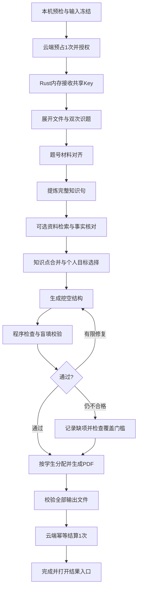

# 个性化知识点挖空听写工作流：完整实施计划

日期：2026-10-28  
状态：设计方案，待实施。本文不表示相应功能已经开发或上线。  
适用项目：错题智能推送 Agent，Windows / Tauri / React / TypeScript / Rust，云端 Fastify + SQLite。

## 1. 已确定的目标与边界

### 1.1 最终交付

用户导入本场考试、上传空白卷后，点击一次“生成报告”，程序自动完成识题、知识点提炼、挖空、校验、按学生分配及 PDF 导出。生成过程中不要求教师标注知识点、确认题干、审核采用或手动组卷。

输出参考用户提供的两页听写样例，但不将该样例的学生资料、题目内容或原文件提交到代码仓库：

- 听写页：学生姓名、考试名称、说明、编号、知识点挖空。
- 答案页：编号对应的参考答案、可接受表述、原题题号、简短纠错说明。
- 每名学生一份 PDF，并生成全班合订 PDF；内容较多自动分页，不强行限制每人两页。
- 无失分的学生输出“本场暂无需补充的知识点”；没扫/无原卷的学生输出状态说明，不虚构个人错误。
- 生成失败时明确失败或部分完成，不将缺失内容伪装成完整报告。

### 1.2 执行位置

按负责人选择，采用“云端核验并下发共享模型 Key，客户端直连模型”的架构。

| 部分 | 执行位置 |
|---|---|
| 软件登录、余额预占、任务授权、心跳、结算 | 负责人云服务器 |
| 共享模型 Key 的下发 | 云端经 HTTPS 下发给桌面 Rust 后端 |
| 工作流状态机、资料处理、检索、分配 | 用户电脑 |
| 模型请求 | 用户电脑 Rust HTTP 客户端直接请求模型服务 |
| 真正的模型推理 | 模型服务商 |
| SQLite 检查点、内容缓存、报告及 PDF | 用户电脑，按软件账号隔离 |

云端不承担试卷 OCR、模型请求转发、知识库全文检索、PDF 排版，不接收全班姓名和逐题成绩。

### 1.3 必须准确表达的限制

共享 Key 到达客户端后，固定工作流、限时、限次、Token 预算和心跳约束的是正常客户端。它们不等同于模型服务商签发的单任务临时凭证，不能保证对修改客户端或提取 Key 的行为进行服务端强制限制。

取消时程序可以停止后续调用，并尝试中断当前 HTTP 请求；不承诺模型服务商立即停止已经收到的请求或免除相关费用。云端拒绝续期/冻结账号对正常客户端有效，不能单独撤销已经泄露的共享 Key。

不以“已机器校验”宣称题目绝对正确；没有教材等外部资料时，不编造教材页码或来源。

## 2. 参考项目、具体文件与采用方式

调研日期为 2026-10-28。以下 SHA 已通过 GitHub commits/main 接口核对为本次参考提交；实施时以这些提交为起点固定参考版本、核验实际使用内容的许可，再调整成项目自己的业务实现，不直接执行外部仓库里的技能或脚本。

### 2.1 主要参考

| 项目 | 本次参考快照 | 重点文件 / 文档 | 借鉴点 | 采用方式 |
|---|---|---|---|---|
| [FrostySL/anki-card-forge](https://github.com/FrostySL/anki-card-forge) | `54e18edef7c0c4bc901240ee12704b2c6747e4af` | `skills/card-authoring/SKILL.md`、`tools/grounding_check.py`、`tools/validate.py`、`tests/test_grounding.py` | 一条核心事实、挖关键词、上下文完整、避免答案泄露、来源核对 | 参考内容规则和测试思路，自行实现 TypeScript 规则；不安装 Claude Code，不引入 Anki 运行环境 |
| [NicholasMcCarthy/pdf2anki](https://github.com/NicholasMcCarthy/pdf2anki) | `bbea5b08c2d335bdfbf54f526027f670468f68ac` | `prompts/cloze_generation.j2`、`prompts/cloze_generation.yaml`、`prompts/reviewer.j2`、`src/pdf2anki/strategies/cloze_definitions.py`、`src/pdf2anki/validate.py`、`tests/test_reviewer.py` | 资料分段、内容生成与审查分离、答案/来源验证、重复内容处理 | 参考阶段划分，自行实现适用于高中原卷与学生失分数据的流程；不直接依赖其 Python SDK 或模型配置 |
| [logannye/ankithis](https://github.com/logannye/ankithis) | `b4fe16fe14e66ec0dc8715ce04de743b80c7832d` | `apps/api/src/ankithis_api/services/pipeline.py`、`services/qc.py`、`services/stages/concept_extraction.py`、`concept_merge.py`、`dedup.py`、`llm/schemas.py` | 先概念提炼/合并，再制作卡片；结构化质量检查与去重 | 参考设计，自行实现；README 的许可标注和独立许可文件需在复制代码前进一步核实，首版不直接复制其实现 |
| [statelyai/xstate](https://github.com/statelyai/xstate) | `060cd63378b46b32e7559d569ed3ad112ee60084` | 官方 [Persistence](https://stately.ai/docs/persistence)、仓库 `examples/persisted-donut-maker/`、`packages/core/src/createActor.ts` | 固定状态、事件、取消和失败转移、执行状态持久化 | 引入稳定版本 `xstate` 核心依赖，实施时核验并锁定版本；不照搬 main 上可能与稳定版不一致的接口 |
| [typst/typst](https://github.com/typst/typst) | 复用本项目已有本地编译器及现有版本锁定 | 项目 `app/apps/desktop/src-tauri/src/pdf_export.rs`、`app/packages/pdf/src/` | 中文 PDF、模板化排版、分页、公式和上下标 | 直接复用现有本地工具，新增听写模板和自动导出流程 |

上述内容工具主要面向 Anki。我们借鉴知识点与挖空处理过程，不生成 Anki 卡包，不引入其网页/账号/数据库整套后端。

固定版本入口：

- [anki-card-forge 参考提交](https://github.com/FrostySL/anki-card-forge/tree/54e18edef7c0c4bc901240ee12704b2c6747e4af)
- [pdf2anki 参考提交](https://github.com/NicholasMcCarthy/pdf2anki/tree/bbea5b08c2d335bdfbf54f526027f670468f68ac)
- [AnkiThis 参考提交](https://github.com/logannye/ankithis/tree/b4fe16fe14e66ec0dc8715ce04de743b80c7832d)
- [XState 参考提交](https://github.com/statelyai/xstate/tree/060cd63378b46b32e7559d569ed3ad112ee60084)

本次已核对 anki-card-forge、pdf2anki 和 XState 的 MIT 许可信息；实际复制/改编时仍须保留对应版权与许可文本。AnkiThis 仅参考设计，不在许可文件问题未核实前复制代码。

### 2.2 暂不引入

- [langchain-ai/langgraphjs](https://github.com/langchain-ai/langgraphjs)：参考其检查点、可恢复执行和幂等思路。当前流程是固定顺序，首版用 XState 即可，不同时引入两套调度框架。
- [docling-project/docling](https://github.com/docling-project/docling)：作为未来复杂 PDF、版面和 OCR 的备选。首版复用 PDF.js、Word 展开及已有图像识别；真实原卷测试证明有明显短板后，再评估引入成本。
- 向量数据库、多 Agent 自由规划、联网自主搜索、模型自行编写并执行任意代码：不进入首版。已有本地 SQLite 检索继续使用。

凡实际复制或改编的开源代码/提示词，实施时在 `THIRD_PARTY_NOTICES.md` 写明来源、版本、许可与改编范围；仅阅读参考不宣称代码已集成。

## 3. 当前代码基础及差异

| 已有模块 | 可复用部分 | 必须改造部分 |
|---|---|---|
| `app/packages/agent/src/preparePaper.ts` | 两次识题、题号匹配、取消检查 | 目前不一致就转人工核对；改为自动定向重读、失败隔离；支持跨页材料 |
| `app/packages/agent/src/index.ts` | 匿名化、失分选题、共享题池、独立解题和有限重出 | 输出从“变式题”改为“完整知识句 + 挖空条目”；取消人工审核状态依赖 |
| `app/packages/agent/src/storage.ts` | 资料/结果一致性校验 | 现有数据强制要求知识库依据和人工审核；新增独立版本的听写任务结构与校验器 |
| `app/packages/knowledge/src/`、`src-tauri/src/knowledge.rs` | 本地资料、FTS 检索、来源页码 | 知识库改成可选，不再空库就阻止识题/生成 |
| `src-tauri/src/model.rs`、`model_http.rs` | 固定供应商端点、结构校验、错误分类、匿名检查 | 新增听写阶段、任务授权、每次调用预算、可取消 HTTP、受控共享 Key 会话 |
| `src-tauri/src/account.rs`、`server/src/app.mjs` | 登录、预占、任务幂等、余额流水 | 新增工作流授权与心跳；由 PDF 验收后结算，而不是第一道自检题通过就扣次 |
| `src-tauri/src/pdf_export.rs` | 本机 Typst、公式转换、超时、临时目录、非覆盖写入 | 听写与答案模板、自动保存、不弹中途选目录、不要求人工 approved |
| `app/apps/desktop/src/AgentWorkspace.tsx` | 进度、取消、账号与本机资料接线 | 调度移出 React 组件；界面精简为生成/停止/恢复/打开结果 |

旧版出题记录、已有 PDF 和历史成绩保留。新增结构使用独立 `workflowVersion` / `schemaVersion`，不把旧版审核结果直接当成新格式听写结果。

## 4. 固定流程与成功定义



用户在点击生成之前准备资料、选择输出设置。之后不弹出题干确认、知识点选择、逐题采用或保存位置对话框。

### 4.1 目标学生与缺失情况

- 目标学生：本场具有可用逐题记录，且当前补练规则下存在失分题的学生。真实的 0 分可参与听写生成；“对比考试排除零分”的规则只属于名次评选，不套用到这里。
- 没扫/无原卷：不推断其失分题，不生成假听写；仍可输出对应状态页并计入全班清单。
- 满分/无纳入失分题：输出无需补充说明，不调用模型为其硬凑条目。
- 主观题只有整题成绩：依据整题相关内容整理复习点，不断言某一小问错在哪里。
- 缺少学生作答选项时，不生成类似“学生 D→正确 B”的个人选项依据。

### 4.2 正式完成条件（首版建议默认，真实资料验证后可配置）

1. 整个输入与任务冻结版本一致，所有目标学生均有状态和分配结果。
2. 每位目标学生至少有 1 条机器校验通过的有效听写条目。
3. 对预先确定的个人目标知识点，覆盖率至少 80%；未覆盖项必须列出。此比例按“选定目标点”计算，不以删除失败项的方式抬高比例。
4. 选定目标之前先保留原始失分题清单。识题失败/知识句无法核实的原题始终显示在未覆盖清单，不因没有提炼出知识点而悄悄消失。
5. 每人 PDF、合订 PDF 和结果清单全部写入成功并通过文件完整性检查。
6. 未发生任务取消、授权拒绝、预算超限或资料版本冲突。

达到门槛但有少量缺项，结果标记“完成，含未覆盖项”。有目标学生完全无有效条目，或低于覆盖门槛，标记“部分完成 / 失败”，保留已有结果及缺项说明，不自动当作正式成功扣次。

80% 是方案默认值，不是已经验证的教学标准，也不是模型正确率承诺；在第一批真实试卷测试中核定。报告不能写“所有知识点已覆盖”或“答案保证正确”。

## 5. 本地状态机、限制与异常处理

### 5.1 固定状态

`idle → preflight → authorizing → rendering → recognizing → aligning → extracting → retrieving → verifyingFacts → merging → selectingTargets → clozing → validating → assembling → exporting → settling → completed`

辅助状态：`retryWait`、`recoverable`、`partial`、`failed`、`cancelled`、`pendingSettlement`。

- 模型只返回本阶段的数据；不能指定下一步、修改预算、执行工具代码或自行打开网页。
- XState 管理状态与事件；Rust 后端重复检查任务、阶段、预算、账号和取消状态，避免只靠按钮禁用。
- 调度器为桌面会话单例，不放在组件的点击处理函数里；切换页面不取消或重复启动任务。
- 同账号同一时刻只有一批活动生成；双击、重复网络提交、重新打开页面都复用任务编号。

### 5.2 建议的初始限制

以下是开发配置初值，须经真实试卷校准后再用于正式用户，不保证这些数值对所有试卷都合适。

| 项目 | 初始规则 |
|---|---|
| 本机模型并发 | 1；先保证稳定，再通过测试决定是否提高 |
| 普通文本请求超时 | 120 秒 |
| 图片识别请求超时 | 240 秒 |
| 整批执行时限 | 45 分钟；超限进入可恢复/失败状态，不继续请求 |
| 单个不合格条目 | 最多定向修复 1 次，再盲填复检 1 次 |
| 网络错误 | 最多 1 次有限重试；认证/余额错误立即停止 |
| 心跳 | 约每 20 秒一次；连续 90 秒无法续验即暂停新模型请求 |
| 输出空数 | 默认每人目标最多 16 空，正常情况下不超过 24 空；不为凑数增加无关知识 |
| 同题原子知识点 | 默认最多 3 个，优先关键概念/必要条件/核心过程 |
| 输入范围 | 不超过现有 30 页限制；首版默认单班不超过 100 人、需要处理的原题单元不超过 80；超过范围在调用前明确提示，不截掉学生后继续 |

调用预算在预检时计算：设有效页数为 P，批处理组数为 B（每组最多 6 个相关原题单元），识题最多 3P 次（两次读取加一次定向修复），内容阶段每组最多 6 次（提炼、事实核对、挖空、盲填、一次修复及复检）。全局额外网络重试最多 8 次，总预算为 `min(200, 3P + 6B + 8)`。材料过长时拆组，拆组后的预算重新核算；一批超过预算在预检拒绝或减少本次目标范围并明确显示，不能静默压缩题目。

每次发起前检查调用剩余额度、阶段上限、输入长度、单次输出上限及整批时间；收到响应后按供应商 usage 记账。Token 预算要包含输入与输出，并预留下一次请求的上限，不能只在所有调用结束后统计。具体总 Token 数与单次输出长度在模型真实请求测试后锁定，不把 Token 数换算成未经核实的固定价格。

没有返回 usage 或发生超时的请求标为用量未知，保守占用预留预算，不能按 0 Token 释放后无限重试。预算减少和检查点写入使用同一事务/受控顺序，防止重开程序后预算计数归零。

### 5.3 取消与恢复

- 停止按钮触发状态机取消和 Rust 请求取消；立即停止队列，不生成下一题。
- 已成功内容和检查点保存，未完成调用标为 `interrupted/unknown`，不得当成功。
- 崩溃重开后，先校验账号、输入摘要、版本和云端任务状态，再允许“继续上次任务”。无需教师审核内容。
- 继续任务时重新向云端领取 Key，绝不从本机 SQLite 恢复 Key。
- 已完成步骤直接复用；已经发出但没收到响应的调用可能已经产生费用，供应商未确认支持幂等时不宣称重发不会重复消费。
- 无法继续时明确结束任务，释放或等待过期释放预占；不偷偷新建一批扣第二次。

## 6. 工作流各阶段的输入输出

### 6.1 本机预检和冻结

检查软件账号、完整考试数据、试卷文件、输出目录写权限、Typst 资源、可分析学生及目标范围。有/无知识库均允许启动。

先在本机创建任务目录与冻结输入快照，再申请云端预占。预检不调用模型、不下发 Key、不扣次。全部学生都没有失分目标时返回无需生成，不建立付费任务。

输入摘要包括：账号标识、考试/班级/学科、学生与逐题成绩、试卷文件摘要、生成设置、知识库版本、工作流/提示词/模板版本。显示页切换和余额刷新不改变摘要；成绩、试卷或目标设置变化使旧结果失效。

### 6.2 文件展开、识别与题号对齐

- PDF/Word 优先提取可用文字，同时保留页码；图片和文字不完整页使用已有视觉调用。
- 两次读取分别保存，不把第一次识别结果当作第二次识别的答案。
- 以程序规则核对题号、选项、单位、否定词、数字、上下标、跨页和共用材料；不能只依赖整段去空白字符串一致。
- 不一致时最多定向重新读取一次。仍有歧义时隔离该题，不要求教师核对、不编造缺失条件。
- 保留独立 `recognized_by_machine` / `alignmentStatus`，不把原有 `confirmed=true` 冒充教师确认。
- 题号必须落在本场可匹配集合；共享材料先组成一个单元，之后保留其各原题编号。
- 图形依赖的知识点要同时保留图形证据；无法可靠识别时跳过依赖具体图值的推断。

### 6.3 提炼完整知识句

以原题单元为输入，输出 1–3 个原子知识点：规范名称、完整正确陈述、关键限定条件、易混概念、候选挖空片段及原题来源。

不直接输出横线版最终试卷。先生成可以独立阅读的完整知识句，避免后续无法核对答案。知识点名称在没有标准目录时属于机器推断，不能伪称来自权威教材目录。

生物例子可使用“细胞分化的实质是基因的选择性表达”一类完整陈述；限定条件、否定词和适用对象必须保留。涉及计算的内容保留给定条件和推导依据，不能只输出一个孤立比例。

### 6.4 可选知识库与题库

- 有可检索资料：用知识点、关键词及原题条件检索；记录文档 ID、页码、片段和原文。
- 找不到合适资料/知识库为空：进入原卷模式，继续生成，不触发现有 `knowledge_required` 全局阻断。
- 资料模式与原卷模式可以在同一批按条目区分。没有命中的条目不能借用别的条目的引用充当证据。
- 原题提供“考查范围”，不等于原题文字本身能证明模型写出的所有事实；原卷模式的结论仍需独立事实核对，保留来源类型。
- 错误干扰项不能直接当知识依据；若没有标准答案，独立解答并检查冲突，无法明确的条目跳过。
- 首版不自动上网搜教材，不要求用户先建库，也不自动把模型输出升级为权威题库。

### 6.5 事实核对、知识点合并与选择

事实核对请求不提供“正确/已审核”标签。检查陈述是否准确、范围是否适合本题、限定条件是否缺失、能否从所给证据支持。冲突时有限修复，失败隔离。

合并只针对语义和适用条件相同的原子事实，不凭知识点名称相同就合并。相近但有不同条件、不同对象或相反方向的陈述必须保留差异。每条合并记录保留全部原题映射。

个人目标由原始失分题与合并后的知识点映射决定。优先全错、失分比例较大、核心基础内容；部分得分按现有教师预设规则纳入。每人最多 16 个默认目标空；复杂情况可预设到 24 个。目标集合在最终质量筛选之前冻结，失败点进入缺项清单。

### 6.6 挖空生成与程序还原

模型输出结构化 `parts`，例如：

```json
{
  "id": "fact-001-cloze-01",
  "factId": "fact-001",
  "sourceNumbers": ["5"],
  "parts": [
    {"type": "text", "text": "细胞分化的实质是"},
    {"type": "blank", "blankId": "b1", "answer": "基因", "acceptedAnswers": ["基因"]},
    {"type": "text", "text": "的选择性表达。"}
  ],
  "correction": "细胞功能趋于专门化，不能概括为所有生理功能均增强。"
}
```

程序把所有 text 和 blank.answer 拼接，必须还原已保存的完整知识句；再用同一结构生成横线和答案页。这样不需要模型分别编两份练习与答案，避免编号错位、填空内容不一致。

每条默认 1 空，确有同一概念内部关系时最多 2 空；不整句挖空，不挖无关虚词，不删除唯一限定条件。答案要与空后已有的“期”“酶”等文字共同组成完整术语，避免重复字或评分歧义。

### 6.7 自动质量检查

程序检查：JSON/字段/大小限制、稳定 ID、原题映射、parts 可还原、空非空、可接受答案一致、句子重复、答案在同条可见文本泄露、编号和空数、公式白名单、无学生身份、无不支持的远程内容。

模型盲填：只提供挖空后的句子、必要材料和作答要求，不提供 answer、acceptedAnswers、生成解析或“已通过”结论。要求返回补全值、歧义和条件缺失情况。

比对分层：程序先做精确/格式/单位归一化；术语用显式 acceptedAnswers；数值使用经限定的计算/单位校验。仍不一致的自由文本不能靠无限询问模型“是否相同”来放行，按失败处理。

事实核对、盲填一致和语法检查分别存储。两次调用一致不是科学正确性的保证，不把单一布尔值 `passed=true` 当成充分证据。

## 7. 个人分配、内容共享与去重

以“原题单元 → 完整知识句 → 挖空条目”为全班共享内容池。相同失分题只生成一组知识点和条目，再分配给需要的学生，不按学生数重复调用。

分配严格根据学生实际失分题及已冻结目标；完整正确的题不凭模型猜测强行分配。跨原题的相同事实只保留一条听写，答案页列出对应原题集合。一个学生的重复知识点去重不影响其他学生。

缓存键至少包括原题内容摘要、学科、资料来源与版本、提示词版本、工作流版本、模型配置、条目参数。命中必须校验这些条件；不得仅按题号复用其他考试。首版只在账号本机缓存，不做跨用户共享。

机器生成内容进入“机器检查内容缓存”，不自动写入人工审核教材/标准知识库；无教材模式的内容不能在下一轮被当成独立权威证据。

## 8. 本机数据结构与检查点

### 8.1 核心对象

| 对象 | 必要字段 | 用途 |
|---|---|---|
| `FrozenInput` | ownerId、examIdentity、students、paperFiles、settings、knowledgeRevision、inputHash | 本批不可变输入，只存在本机 |
| `WorkflowRun` | runId、cloudJobId、requestKey、workflowVersion、promptVersion、templateVersion、inputHash、state、policy、counts、deadline、timestamps | 状态与版本恢复，不含 Key |
| `SourceUnit` | unitId、sourceNumbers、pageIds、material、stem、options、recognitionChecks、availability | 原题和共用材料单元 |
| `KnowledgeFact` | factId、sourceNumbers、knowledgePoint、completeStatement、conditions、evidenceRefs、sourceMode、factCheck | 可核对的完整知识句 |
| `ClozeItem` | itemId、factId、sourceNumbers、parts、correction、checks、status、attempts | 听写条目和答案共用一个结构 |
| `StudentAssignment` | localStudentId、selectedTargets、itemIds、uncoveredTargets、status | 学生分配，姓名在最终本地排版时关联 |
| `CallRecord` | callId、stage、unitIds、requestHash、status、attempt、reservedBudget、usage、startedAt、finishedAt、errorCode | 调用记账及异常恢复，不记录 Key/请求头 |
| `ExportManifest` | runId、inputHash、outputs[{relativePath,size,sha256,pages}]、coverage、resultStatus | 文件验收与幂等结算依据 |

模型阶段只接收必要题干、原题编号和匿名统计；不接收学生姓名、名单、个人账号。Key 不放进 XState context，不交给 React，不写入检查点、错误文本、日志或 PDF。

### 8.2 存储布局

建议在当前账号目录新增：

```text
accounts/<账号ID>/
  workspace.sqlite                 # 现有当前考试和成绩历史，保持兼容
  knowledge.sqlite                 # 现有知识库，继续复用
  workflow.sqlite                  # 新工作流、条目、检查点和调用记账
  generation-files/<runId>/
    input/                         # 冻结的本次试卷内容或按哈希引用的副本
    intermediate/                  # 可恢复的识题结果、完整知识句、检查结果
    export-staging/                # 尚未完成验收的 PDF
  reports/<考试名称>-<任务短ID>/
    students/student-001.pdf
    students/student-002.pdf
    class-dictation.pdf
    manifest.json
```

首版沿用稳定编号文件名，姓名放在 PDF 内及本机清单映射中；避免姓名中特殊字符或重名造成路径问题。导出目的地可以在生成前预设一次，默认当前账号本机 reports。运行过程中不弹保存目录对话框。

`workflow.sqlite` 建议包含 `workflow_runs`、`workflow_units`、`knowledge_facts`、`cloze_items`、`student_assignments`、`model_calls`、`export_manifests`。所有记录带 runId/版本，必要外键、唯一键和事务。原始图像不重复塞进每个条目。

每步成功后先持久化结果再进入下一步。调用前写入 callId/预算/请求摘要，响应后原子写入完成状态和 usage；同一个 callId 不允许并发执行。XState 保存/恢复的是可序列化状态，实际调用结果从持久化检查点取回，不序列化 AbortController、HTTP 连接、Key 或函数。

### 8.3 恢复和幂等

- 完成步骤缓存与当前 runId / inputHash / 版本匹配后才可复用。
- PDF 失败重试只做排版，不重新识题或生成知识点。
- 结算失败重试只调用云端 finish，不再调用模型。
- 重开程序发现未结束任务，显示阶段、可恢复范围、是否已结算和已有文件；使用同一 requestKey/jobId 恢复。
- 改动成绩、试卷、知识库或生成设置后，创建新输入版本；旧任务资料保留但不能拼到新任务里。
- 切换账号立即停止旧账号调度和请求，清空本机内存 Key；不得读取另一个账号的检查点。

## 9. 共享 Key、授权与云端接口

### 9.1 Key 管理

共享 Key 配置在云服务器受限配置中，不写源码、前端资源或 Git。建议给本产品使用独立 Key，便于负责人在模型平台手动轮换；轮换影响范围应清楚展示。

Key 只通过认证后的 HTTPS 接口下发到桌面 Rust 内存。前端调用本机“领取授权”命令，只得到任务 ID、模型配置、额度策略和状态，不能得到 Key 字符串。领到 Key 后，Rust 使用固定模型端点直接发请求。

凭证接口设置 `Cache-Control: no-store`，不把响应正文写入普通服务端/代理访问日志。模型 Key、软件登录 token、学生内容分别处理，不混进一份可记录的 DTO。

本地授权到期、正常结束、取消、登出或切换账号时清空 Key。云端 lease 是“正常客户端继续执行的授权”，不是 DeepSeek Key 本身的有效期，界面和文档必须保持这一用语区别。

### 9.2 接口草案

新增版本化工作流接口，保留当前旧客户端的 v1 接口兼容，不原地改变旧请求结构。

| 接口 | 输入 | 输出 / 行为 |
|---|---|---|
| `POST /v2/dictation-runs` | requestKey、inputHash、workflowVersion、无身份的 pages/unitCount/studentCount、预计调用预算 | 核验账号、余额和范围，事务预占 1 次，返回 jobId、state、policyVersion、limits、leaseUntil、expiresAt；重复 requestKey 返回原任务 |
| `POST /v2/dictation-runs/:id/credential` | 已认证任务所有者请求 | 仅对仍活动的本账号任务返回共享 Key 和固定模型配置；正文仅 Rust 接收 |
| `POST /v2/dictation-runs/:id/heartbeat` | stage、完成计数、调用/Token 汇总 | 返回 continue/cancel、leaseUntil；不上传题目、学生姓名、整张成绩表 |
| `GET /v2/dictation-runs/:id` | 账号凭证与 jobId | 恢复/结算时核验任务状态、归属、预占和完成结果 |
| `POST /v2/dictation-runs/:id/finish` | outcome、manifestDigest、无身份的文件数量/覆盖摘要/用量 | 幂等完成并扣 1 次，或取消/失败释放；重复完成只扣一次 |

不提供任意聊天接口，不提供由客户端填写任意模型端点的接口。模型请求结构和阶段由客户端固定实现；服务端只控制下发授权、预占和状态，不能把这些接口描述成可防改包的模型网关。

请求契约示例（全部是虚构占位值，不含学生资料或真实凭据）：

```json
{
  "requestKey": "<本次任务UUID>",
  "inputHash": "<冻结输入SHA256>",
  "workflowVersion": "dictation-v1",
  "promptVersion": "dictation-prompts-v1",
  "counts": {"pages": 4, "units": 18, "students": 50},
  "requestedBudget": {"maxCalls": 38, "maxRunSeconds": 2700}
}
```

服务端核验并返回任务实际 policy，不照单接受任意 requestedBudget。Key 接口的响应包含 `jobId`、`modelKey`、固定供应商/模型配置和 lease 信息，Rust 校验所属任务后保存至内存，返回给 JavaScript 的对象必须剔除 `modelKey`。

finish 的 `outcome` 枚举建议为 `completed`、`partial`、`failed`、`cancelled`；只有 `completed` 且本地 manifest 已验收时发起成功结算。服务端依赖客户端声明的事实边界见 9.3。HTTP 超时重试使用相同 requestKey/jobId，状态已完成时返回原 charged 结果。

云端新增工作流元数据表关联现有 generations，保留 credit_ledger 唯一引用防重复扣减。schema 升级前备份、迁移测试、版本检查和回滚方案必须先完成；共享 Key 不进 generations 或流水表。

### 9.3 心跳、到期与停止

云端每次 heartbeat 是小体积状态请求，不承载模型内容。正常客户端失去授权、账号被冻结或服务端返回取消时，停止队列并清空 Key。云端任务到期不能靠缓存 lease 自动延长。

现有预占最长 2 小时可作为首版绝对任务窗口；45 分钟是活动执行限制，暂停/恢复仍受绝对截止时间约束。到期后已完成内容和 PDF 保留，但新调用必须重新核验；不能默默另建收费任务继续。

服务器无法通过该心跳核实客户端实际消耗、生成质量或 Key 的全部使用。客户端上报的 usage/完成状态只能作为本架构的业务记录，不宣称是供应商账单或不可伪造的完成证明。

## 10. PDF 模板与验收

### 10.1 模板

- A4、中文字体、黑白打印友好，标题居中、正文编号连续。
- 标题使用本地学生姓名和考试名称；说明自动列出本页/本份空数与参考用时，时间仅为估算。
- 练习页只显示 text 与横线；横线按答案长度划分有限档位，保留足够书写空间。
- 答案页自动编号，展示参考答案、可接受表述及简短纠错/复习提示。
- 原题对应关系默认放在答案与说明页，帮助追溯；无选项数据时不出现个人错选项。
- 模型内容作为普通文字/有限公式处理，不能让模型生成任意 Typst 程序。
- 化学/生物上下标、希腊字母、分数比例和常见公式沿用现有受控转换；不支持的表达应在排版前处理，不输出乱码。
- 全班合订从每位学生的新页开始；启用双面打印模板时再增加偶数页补齐策略，不能默认让前一人的答案与后一人的练习混页。

### 10.2 本地导出

使用现有 Typst 编译器；先写 staging，再验收，最后以新目录提交到输出位置。不得覆盖旧考试报告。默认不经服务器、不要求模型生成二进制 PDF，不引入额外在线 PDF 转换服务。

检查项：PDF 头与可读取性、实际页数大于 0、目标文件数量、编号/空/答案一一对应、所有目标学生有输出、没有缺字或公式异常、答案没有出现在练习页、没有临时水印冒充正式报告、合订顺序与个体一致。保留 size/hash/pages 到 manifest。

开发阶段必须对典型输出渲染看图；运行时进行可执行的结构检查和编译失败处理，不声称靠文件头就验证了版式或科学内容。

## 11. 计次与交付事务

### 11.1 新完成时点

当前代码在模型生成至少一条通过自检后即可确认扣次，且之后才保存和审核。新工作流改为：

1. 预检通过，云端预占 1 次，余额可用量减少但尚未写成功扣减流水。
2. 客户端完成内容、分配和全部 PDF 验收，持久化 manifest。
3. 客户端用原 jobId / requestKey 幂等提交成功。
4. 云端事务写完成状态及扣 1 次流水，返回结果。
5. 客户端显示正式完成和 PDF 路径；查看、复制、下载本机已有结果不扣次。

已完成内容但网络无法结算：进入 `pendingSettlement`，保留文件和 manifest，恢复只重试 finish。云端已扣而响应丢失时，查询/重提同一任务返回原结果，不再次扣减。

### 11.2 失败和部分完成

| 情况 | 用户次数处理 | 本机结果 |
|---|---|---|
| 预检失败、没有失分目标 | 不预占、不扣 | 显示原因 |
| 识题/内容校验失败且不足覆盖门槛 | 释放预占，不成功扣次 | 保留部分内容与失败清单，明确未完成 |
| 用户取消、超时、预算耗尽 | 停止并释放或到期释放预占 | 可恢复检查点，不能伪装完成 |
| PDF 编译/写入失败 | 不提交成功 | 重试排版可复用已有内容 |
| 完整交付但 finish 断网 | 保持待结算，不建新任务 | 保留完整文件，幂等恢复结算 |
| 已结算后重新打开/导出同批文件 | 不重复扣次 | 优先复用已生成 PDF |

用户次数不等同于供应商模型费用。前述失败不扣用户次数，不代表已经发出的模型调用没有成本。共享 Key 架构仍依赖正常客户端上报完成，不能将“本地 manifest 摘要”当成服务端已核实 PDF 内容。

## 12. 模块与文件改造清单

建议新增文件名可在实施时微调，但职责保持清晰。

| 路径 | 计划工作 |
|---|---|
| `app/packages/agent/src/dictation/types.ts` | 任务、原题单元、知识句、parts、检查、分配和 manifest 类型 |
| `app/packages/agent/src/dictation/machine.ts` | XState 固定状态、事件、失败/取消/恢复转移 |
| `app/packages/agent/src/dictation/runner.ts` | 纯业务调度，依赖注入，不直接依赖 React |
| `app/packages/agent/src/dictation/prompts.ts` | 识题/知识句/事实核对/挖空/盲填的版本化模板 |
| `app/packages/agent/src/dictation/validators.ts` | JSON、parts 还原、答案、歧义、重复和范围规则 |
| `app/packages/agent/src/dictation/assignment.ts` | 目标冻结、失分映射、个人去重和覆盖计算 |
| `app/packages/agent/src/dictation/budget.ts` | 调用、重试、输出长度、Token 和时间预算 |
| `app/packages/agent/src/preparePaper.ts`、`app/packages/paper/src/` | 自动对齐、页/材料溯源和机器确认状态 |
| `app/apps/desktop/src-tauri/src/workflow_store.rs` | 本机任务表、冻结输入、检查点、调用账本和 manifest 事务 |
| `app/apps/desktop/src-tauri/src/model.rs`、`model_http.rs` | 新阶段的固定输入结构、Key 内存绑定、超时/取消及预算重复校验 |
| `app/apps/desktop/src-tauri/src/account.rs` | v2 授权/领 Key/心跳/状态/结算的 Rust 封装 |
| `app/apps/desktop/src-tauri/src/pdf_export.rs`、`app/packages/pdf/src/` | 新听写模板、自动导出、manifest 验收；旧 PDF 格式保持可读 |
| `app/apps/desktop/src/AgentWorkspace.tsx` | 精简界面，连接单例服务，不再承担整条 async 工作流 |
| `app/apps/desktop/src/ScoreWorkspace.tsx` | 冻结期间的资料改动控制、读取已有听写结果，不影响历史成绩分析 |
| `server/src/app.mjs`、`database.mjs` | v2 工作流接口、元数据迁移、幂等及预占/结算事务 |
| `tests/` | 新流程、异常、PDF、本机恢复、接口兼容与实际界面检查 |

不一次性删除旧 `AgentBatch` / practice 结构。新格式单独存储并明确版本，旧记录提供查看/旧 PDF 打开，避免升级后旧考试无法读取。

## 13. 分阶段实施与每阶段完成标准

### 阶段 A：数据模型、纯流程与模拟输入

先加入新类型、XState 核心依赖、固定状态机、预算、parts 校验、分配和内存模拟持久化接口，不接云端 Key、不调用真实模型。用用户样例的版式要求编写合成内容夹具，不带真实学生资料。

完成标准：无知识库和有知识库两条路径均能在模拟模型下运行到同样的听写结果结构；没有人工确认节点；调用次数可确定；输出内容与答案能由程序还原。

### 阶段 B：听写 PDF 与离线完整链路

先做一名合成学生的练习/答案模板，再扩展全班个体与合订。接入本机存储、manifest、文件重试和自动保存。此阶段不增加真实模型花费。

完成标准：中文、上下标、比例和长句可读；练习/答案一一对应；全部学生输出齐全；失败文件不报告完成；已有数据和旧 PDF 不受影响。

### 阶段 C：本机持久化、取消与恢复

加入 SQLite 任务表、调用日志、冻结输入、账号隔离、状态恢复与幂等。验证切换页面、崩溃、重启、输入改变和重复点击。

完成标准：重开后可以恢复已完成步骤；PDF 失败不重跑模型；不能用旧输入结果覆盖新考试；没有 Key 落盘。

### 阶段 D：云端授权和共享 Key 协议

先用本机临时账号服务和假 Key 验证 v2 接口、lease、限额、归属、冻结、到期和 finish 幂等。云端生产迁移在本地接口与迁移测试通过后另行执行，不在写计划时访问或修改服务器。

完成标准：预检失败不会领取 Key；Key 仅进 Rust 内存；取消和登出后停止；同一任务只预占/扣减一次；旧 v1 客户端不会被接口变更破坏。

### 阶段 E：真实模型适配与自动检查

连接既定模型，先做单页识别、单原题单元知识句和挖空，确认结构/usage/超时，再扩展整批。不要一开始直接运行全班全部题。

完成标准：无库模式能产生可检查内容；有资料时保留真实来源；错误和格式异常按既定上限修复；盲填请求确实不含标准答案；没有无限循环。模型参数以官方当前接口与实测为准，不沿用未验证的配置。

### 阶段 F：界面和完整结算接线

生成页只保留开始前设置、生成、停止、进度、恢复、结果入口及失败摘要。移除真实流程对用户 API Key 输入、空白卷人工确认、题干逐题确认和逐题采用的依赖；内部可保留开发诊断入口，不向普通用户暴露任意提示词或任意请求面板。

完成标准：从一次生成点击到 PDF 保存和结算没有教学审核操作；正常完成扣 1 次；部分失败按规则处理；导出/重开同批不重复扣费。

### 阶段 G：真实资料验收、发布及交接

使用负责人提供的真实空白卷和考试，在明确的模型费用预算内验收完整流程；运行过程中不要求教师参与，开发验收时可以事后抽查内容以评估质量。真实样例、账号数据和 Key 不提交 GitHub。

完成标准：功能与限制均有实际记录；比较至少包含基础概念、计算、共用材料、图示及跨页情形；统计错误/跳过/覆盖/耗时/模型用量，校准预算与默认空数。测试通过后更新进度表、构建并同步实际打开入口，再发布代码与部署说明。

## 14. 测试矩阵与验收数据

| 类别 | 必须验证 |
|---|---|
| 输入 | 无知识库、空知识库、PDF/Word/图片、坏文件、缺少试卷、无失分、没扫/无原卷、真实零分 |
| 识题 | 题号重复/缺失、选项缺字、否定词变化、单位/上下标、跨页、共用材料、图形不可辨认 |
| 内容 | 不完整句、错误干扰项误当事实、知识点重名但条件不同、计算不一致、无依据伪造引用 |
| 挖空 | parts 无法还原、整句挖空、空答案、多个合理答案、答案泄露、答案重复、空后术语重复、数量不足 |
| 自动检查 | 盲填不带答案、失败只修复一次、未通过不分配、模型检查不覆盖程序否决 |
| 调度 | 双击、状态乱序、单请求超时、整批超时、预算不足、连续错误、取消时正在请求、迟到响应 |
| 恢复 | 保存后崩溃、调用中崩溃、PDF 失败、结算响应丢失、授权过期、输入/版本变化、账号切换 |
| 计次 | 失败释放、完成只扣一次、PDF 失败不先扣、重复 finish、跨账号任务拒绝、冻结停止正常客户端 |
| PDF | 每人/合订一致、所有学生有状态、无答案泄露、长中文/公式、分页、缺字、文件损坏、磁盘满/无权限、旧报告不覆盖 |
| 回归 | 登录管理、成绩读取和历史、三条均分趋势、试卷上传、本地知识库、旧版考试与 PDF 仍能查看 |

先使用合成模型响应与临时数据库完成确定性验证，再进行少量真实模型测试。测试应验证行为和失败恢复，而不是只断言某个实现函数被调用。

真实验收记录至少包含：试卷页数、原题单元数、目标学生数、事实/挖空通过与跳过数、个人覆盖率、全部 PDF 数、各阶段耗时、调用次数、供应商返回用量、是否发生恢复和结算结果。没有正式题干/答案时不伪造“准确率”；内容抽查要明确抽查范围及判定依据。

## 15. 首版默认决策和待实测参数

### 本计划固定的方向

- 全自动知识点挖空听写，不以新编选择题/长篇变式为主。
- 模型 Key 经服务器授权后下发到客户端 Rust 内存；模型交互与固定工作流在本地。
- XState 管理固定流程；不做模型自由规划，不安装多套 Agent 框架。
- 有资料检索增强，无资料依据原卷；不再把知识库作为必填项。
- 全班共享知识点条目池，按个人失分分配；程序生成挖空和答案对应关系。
- 自动检查不等同于人工确认；不伪称对错因、教材出处或正确率有额外证据。
- 本机 Typst 导出每人及合订 PDF；正式交付验收后幂等扣 1 次。
- 异常有限重试、可停止、可恢复；重新导出既有结果不重复调用模型或扣次。

### 开发中用真实资料校准，不擅自当成已验证事实

- 单次/整批时间、Token 和调用总预算。
- 每人 16 空、上限 24 空的适用范围。
- 目标覆盖率 80% 的门槛及缺项说明是否满足实际使用。
- 不同题型的识题和知识句质量，图示依赖处理，中文公式渲染。
- 本机性能与单批学生/题数范围，云端 heartbeat/授权接口的实际负载。

如需调整费用、允许部分完成仍扣次、增加外部资料上传或改变共享 Key 架构，应单独说明变更，不能在实施中默默替换本文约定。

## 16. 完成后的文档与交付

实施完成时交付：新工作流源码与依赖锁定、版本化提示词、听写 PDF 模板、模拟测试、真实资料验收记录（本机私有）、服务器接口与迁移说明、停止/恢复/计次说明、Windows 可运行版本，以及更新后的 `计划进度表.md`、`app/README.md`、`server/README.md` 和第三方许可说明。

本计划先作为后续开发依据。此轮只新增计划和进度记录，不安装 XState、不下发 Key、不调用真实模型、不修改业务逻辑、不部署云端服务。
